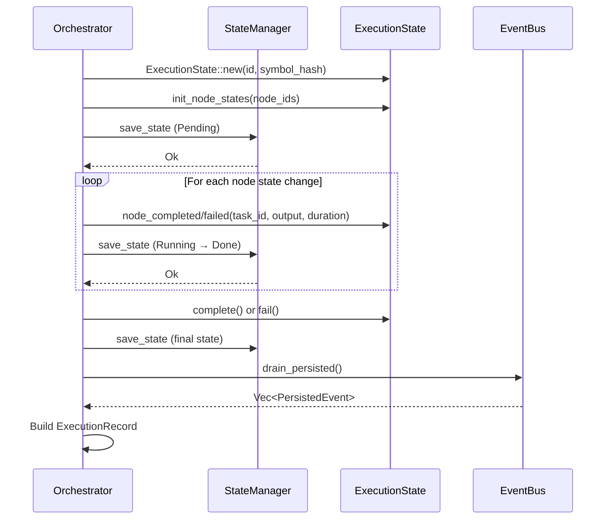

# State Persistence Architecture

<!--
Canonical Reference: .pi/architecture/modules/state-persistence.md
Blueprint Source: Domain Exploration Session 63c25384
Last Updated: 2026-10-21 — ADR-019: NodeStatus gains Dispatched/Ambiguous (both non-terminal)
-->

## Overview

Persists execution state to disk using atomic write-rename for crash safety. Tracks overall execution status (Pending, Running, Completed, Failed, Cancelled) and per-node state (Pending, InProgress, Dispatched, Ambiguous, Completed, Failed, Skipped). `Dispatched` and `Ambiguous` are non-terminal; the latter blocks dependents and retry until provider evidence resolves it (ADR-019). Supports TUI graph persistence for viewing past executions.

## Responsibilities

- Persist ExecutionState to disk via atomic write-rename (`{id}.json.tmp` → `{id}.json`)
- Track per-node state transitions (Pending → InProgress → Completed/Failed)
- Record node output, errors, retries, and duration
- Hash symbol graph state at execution start for replay determinism
- Persist ExecutionGraph for TUI "view past execution" mode
- Support cross-process locking via fd-lock

## Components

| Component | File Path | Purpose | Canonical Section |
|-----------|-----------|---------|-------------------|
| ExecutionState | `rigorix/src/state/persistence.rs` | Serializable execution snapshot | #state |
| NodeState | `rigorix/src/state/persistence.rs` | Per-node state with status, output, retries | #node-state |
| StateManager | `rigorix/src/state/persistence.rs` | Atomic persistence with file locking | #manager |
| ExecutionGraph | `rigorix/src/state/graph.rs` | Graph structure for TUI history view | #graph |
| GraphManager | `rigorix/src/state/graph.rs` | Persistence for ExecutionGraph records | #graph-mgr |
| ExecutionRecord | `rigorix/src/state/context.rs` | Complete execution record (events + context) | #record |

---

## Component Details

### ExecutionState

**Purpose:** Serializable snapshot of an entire execution

**Implementation File:** `rigorix/src/state/persistence.rs`

```rust
pub struct ExecutionState {
    pub execution_id: Uuid,
    pub status: ExecutionStatus,       // Pending, Running, Completed, Failed, Cancelled
    pub started_at: DateTime<Utc>,
    pub completed_at: Option<DateTime<Utc>>,
    pub node_states: IndexMap<Uuid, NodeState>,  // Ordered map for deterministic serialization
    pub symbol_graph_hash: String,

    // ── Approval & identity evidence (additive, serde-defaulted) ──
    /// Durable human-approval records (intent hash, approver, TTL, nonce, status).
    pub approval_records: Vec<ApprovalRecord>,
    /// Attributed identity of the run author (redacted summary).
    pub identity: Option<IdentityClaim>,
}

pub enum NodeStatus { Pending, InProgress, Completed, Failed, Skipped, AwaitingApproval, IntentMismatch }

> **Vocabulary note (intentional, pre-existing):** this persisted snapshot vocabulary (`InProgress`) deliberately differs from the runtime executor vocabulary in execution-engine.md (`Ready`/`Running`) — the mapping `NodeExecutionState → NodeState` happens at the state-persistence boundary. Both gain the two new approval variants consistently. Unifying is a follow-up cleanup (serialized-state migration required).

pub struct NodeState {
    pub node_id: Uuid,
    pub status: NodeStatus,
    pub output: Option<String>,
    pub error: Option<String>,
    pub retries: u8,
    pub duration_ms: Option<u64>,
}
```

### Durable Approval Records (Contract Amendment)

See [approval module](./modules/approval.md) for the full contract. This module provides the **operational (mid-run)** durability tier:

- `approval_records: Vec<ApprovalRecord>` — appended at approval time, survives cross-process resume (GAP-3), queryable via `ApprovalService::get_approval`
- The **evidence (end-state)** tier is the signed envelope (`audit` module) — the envelope's HMAC covers the records transitively
- `identity: Option<IdentityClaim>` — durable run-author identity for continuity and audit

**Migration rule (security-validator pass/fail):** legacy persisted `approved: Vec<Uuid>` sets (pre-binding) carry no intent hash and no decision record. On hydrate, legacy approvals are **invalidated** → re-approval required. No records are fabricated — fabricating would break the binding guarantee on upgrade.

### StateManager

**Purpose:** Atomic persistence with cross-process locking

```rust
pub struct StateManager { /* state_dir: PathBuf, mutex: tokio::sync::Mutex */ }

impl StateManager {
    pub async fn new(state_dir: PathBuf) -> Result<Self, StateError>;
    pub async fn save_state(&self, state: &ExecutionState) -> Result<(), StateError>;
    pub async fn load_state(&self, execution_id: Uuid) -> Result<ExecutionState, StateError>;
}
```

**Persistence pattern:** Write to `{execution_id}.json.tmp` → `fs::rename` to `{execution_id}.json`. On POSIX, `rename(2)` is atomic — a power failure during write leaves the original file intact.

---

### Settlement records (#1569)

`<state dir>/<execution_id>.settlement.json`, written by `FileSystemSettlementStore` as a temporary file
plus a rename, in the same directory the state repository owns.

**The write reads first.** A settlement carries the receipt the run answers (`receipt_digest`), so it is a
sealed record under ADR-024 §6 rule 3: a second write for the same execution under a **different** receipt
is `StateError::SettlementSealedChanged`, naming both digests, and the record on disk is untouched. A record
that cannot be parsed is `CorruptedState` rather than an invitation to overwrite it.

What is compared is the receipt digest, not the file: a settlement accrues effects and a terminal state over
its life, so byte equality would refuse the close that makes the record useful. The seal is **which receipt
the record answers**; everything else about it is meant to change.

The check is at two layers for one reason: `SettlementService::open` refuses before constructing anything, so
a different `SettlementStore` implementing the port cannot skip it, and the adapter refuses before replacing
anything, so a file written by anything else cannot replace a seal. Each has its own test, because a test that
only exercised the use case stays green with the adapter's guard removed — measured.

### The writers re-create their directory (#1572)

Every store in this module creates its directory in its constructor, and **that guarantee does not survive
the process**: a deployment that recreates its runtime directory per run removes the parent while the server
is alive, and the failure then lands at the end of a governed run — after the steps executed — as
`Failed to write temp state file …: No such file or directory`.

So `save`, `save_record`, `save_graph` and `put` each call an `ensure_dir` before writing. The cost is one
`create_dir_all` on a directory that is usually already there; what it buys is that the three outcomes stay
three — a refusal before dispatch, a completed record, or half of each — instead of collapsing into the
third.

The construction-time refusal names the resolved path and `RIGORIX_STATE_DIR`, because that is the moment an
operator can still act on it rather than the end of a run.

## Data Flow



**Write-Rename Pattern:**
```rust
// Atomic write-rename (crash-safe)
fs::write("{id}.json.tmp", &json)?;   // Write to temp
fs::rename("{id}.json.tmp", "{id}.json")?;  // Atomic rename
```

**Flow Description:**
1. ExecutionState created with symbol_graph_hash for replay determinism
2. State saved at each phase: Pending → Running → Completed/Failed
3. NodeState tracks individual node status (Pending→InProgress→Completed/Failed/Skipped)
4. At execution end, EventBus drains all persisted events into ExecutionRecord
```

---

## Dependencies

### Depends On
- **Event System**: ExecutionRecord collects drained events
- **DAG Engine**: ExecutionGraph from TaskGraph

### Used By
- **Orchestrator**: Orchestrator::run() saves state at each phase

---

## Testing Requirements

| Test Type | Coverage Target | Files |
|-----------|-----------------|-------|
| Unit | 90% | `rigorix/src/state/persistence.rs`, `rigorix/src/state/graph.rs` |

**Key Test Scenarios:**
- Save state → file exists at expected path
- Load state → returns saved ExecutionState
- Atomic write: .tmp file removed after successful write
- Node state transitions: Pending → InProgress → Completed
- Parallel saves don't corrupt state
- Approval records persist across save/load (round-trip)
- Hydrate with legacy `approved` (no records) → invalidated, re-approval required
- Hydrate with `approval_records` → records restored, verification continues

---

## Performance Considerations

| Metric | Target | Monitoring |
|--------|--------|------------|
| State write | < 10ms per save | Tracing spans |
| State load | < 5ms | Tracing spans |

---

Last updated: 2026-08-28
*Module version: 1.1.0*

---

**Status:** Implemented  
**Last verified:** 2026-08-28 (durable approval records — contract amendment)  
**Module version:** 1.1.0
