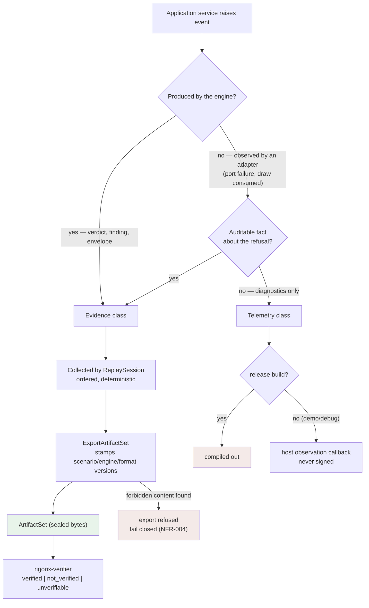
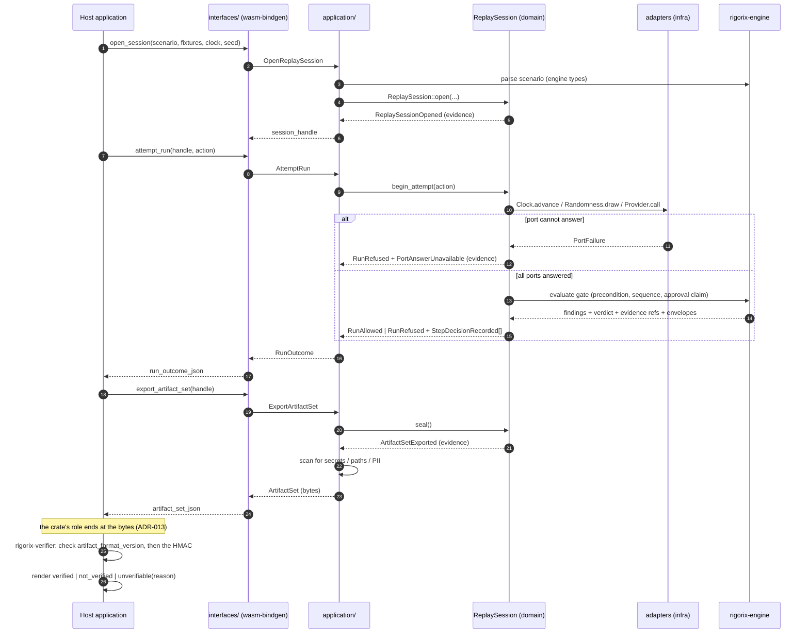

# Event Flow

<!--
Canonical Reference: .pi/architecture/diagrams/event-flow.md
Related ADRs: ADR-003 (evidence vs telemetry), ADR-010 (sealed artifact set)
-->

## Context

One bounded context, in-process events only: no broker, no outbox, no async runtime
(`wasm32-unknown-unknown`, single-threaded). The interesting question is not *transport*
but **which events become evidence** and which stay diagnostics.

## Event Classification Flow

## Sequence Across the Boundary

## Event Catalogue by Destination

| Event | Class | Destination | Signed? |
|-------|-------|-------------|---------|
| `ReplaySessionOpened` | Evidence | Artifact set (session stamp) | via envelope |
| `StepDecisionRecorded` | Evidence | Artifact set (ordered step outcomes) | via envelope |
| `RunAllowed` | Evidence | RunOutcome + artifact set | via envelope |
| `RunRefused` | Evidence | RunOutcome + artifact set | via envelope |
| `PortAnswerUnavailable` | Evidence | Artifact set (refusal grounds) | via envelope |
| `ArtifactSetExported` | Evidence | Host observation + export stamp | n/a (export boundary) |
| `RandomDrawConsumed` | Telemetry | Debug callback only | never |

---

*Generated from session: 3baf6e5c-e352-4127-af09-a5e7fe0a2d29*
*Date: 2026-11-03*