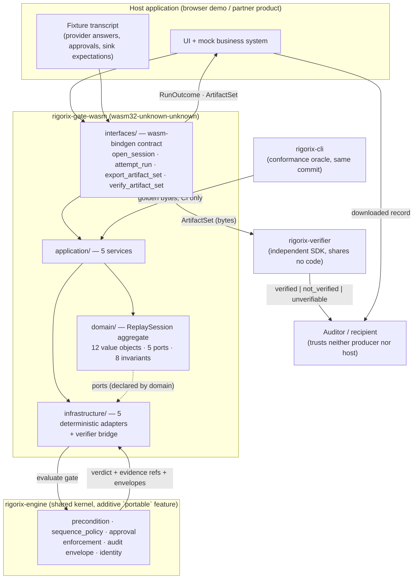
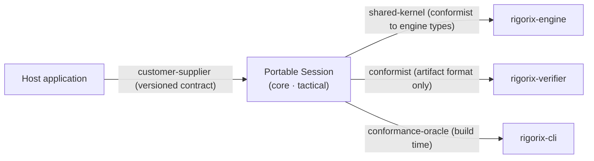
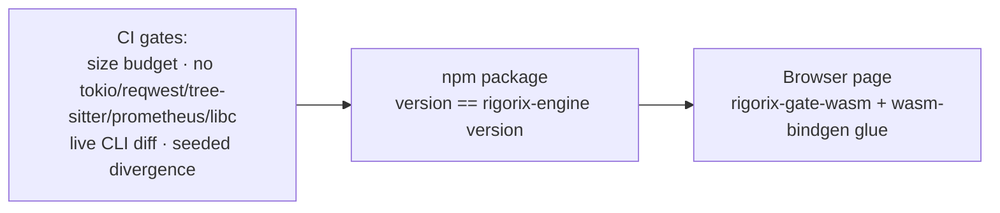

# System Context Diagram

<!--
Canonical Reference: .pi/architecture/diagrams/system-context.md
Related ADRs: ADR-001 (one context, layered seam), ADR-004 (host contract), ADR-009 (conformance oracle)
-->

## Context

`rigorix-gate-wasm` compiles a slice of the Rigorix engine to WebAssembly so a host
application can run the **real** gate locally: evaluate whether an AI agent's proposed
action may proceed, refuse it with evidence, produce signed envelopes, and verify them
offline — byte-identically to the CLI for the same input.

The crate owns **one** bounded context (`Portable Session`) and borrows everything else.

## System Context

## Trust Boundary

| Direction | Crosses | Why it is safe |
|-----------|---------|----------------|
| Host → crate | fixtures, clock readings, seed, approval **claims**, action parameters | Treated as data the engine evaluates; never authority (FR-009) |
| Crate → host | `RunOutcome`, `ArtifactSet`, `VerificationResult`, telemetry observations | No secrets, no key material, no host paths, no PII (NFR-003) |
| Crate → engine | scenario reference, fixture answers via engine ports | Engine decides; the crate only supplies answers |
| Engine → crate | findings, verdicts, envelopes, evidence refs | Verbatim projection; never re-encoded (ADR-010) |
| Crate → verifier | sealed artifact bytes | The artifact format is the entire contract (ADR-010) |
| CLI → conformance | bytes for the same vector | Build-time only; never shipped (ADR-009) |

## Bounded Context Flow

## Deployment View

---

*Generated from session: 3baf6e5c-e352-4127-af09-a5e7fe0a2d29*
*Date: 2026-11-03*