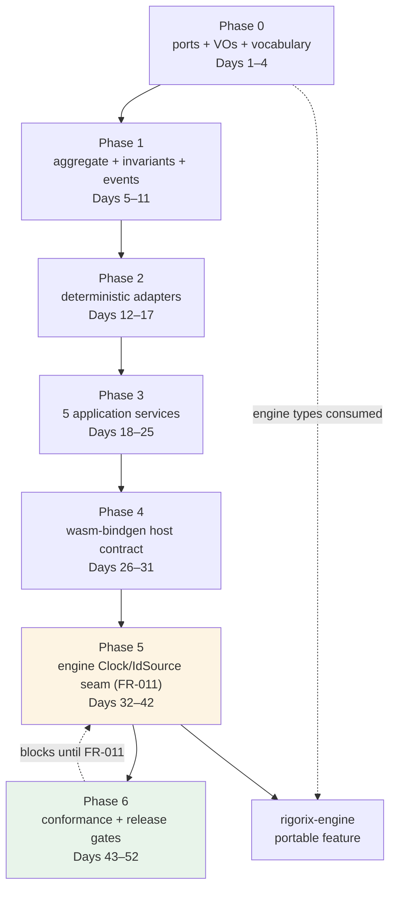

# Implementation Roadmap

<!--
@canonical .pi/architecture/implementation-roadmap.md
Status: Proposed
Date: 2026-11-03
Session: 3baf6e5c-e352-4127-af09-a5e7fe0a2d29
Module: .pi/architecture/modules/portable-session.md (tactical, core)
-->

## Overview

One bounded context (`Portable Session`), one crate (`rigorix-gate-wasm`), four layers. Phases
follow the dependency chain the module doc declares, preceded by three prerequisites: a
feasibility spike (P1), the engine's determinism seam (P2/FR-011) and workspace registration
(P3/ADR-011). See `modules/portable-session.md#prerequisites` for the state of each.

Three constraints shape the order:

- **FR-011 blocks FR-007.** The conformance claim cannot be proven until the engine
  exposes an additive `Clock`/`IdSource` seam reachable from the CLI. It is therefore a
  **parallel track from day 11** (Phase 5), not a later phase: the crate's central claim
  must not sit behind the crate's own last phase. Until it lands, criteria 19–22 read
  *blocked* — `normalised_comparison=true` is a report label on a failing claim, never a pass.
- **The spike precedes the crate.** Phase -1 proves the engine slice compiles to wasm and
  that one envelope matches, before Phase 0 commits four days.
- **No phase ships a green build that hides a red claim.** A normalised comparison is a
  labelled interim (FR-012), displayed as such, and deleted — not relaxed — when FR-011
  lands.

**There are no database migrations in this project** (ADR-002). The sections are kept for
format consistency and state the fact explicitly rather than being deleted silently.

---

## Phase -1: Feasibility Spike (Days 0–10, may fail cheaply)

**Goal:** prove the crate is buildable before anything is built. Three assertions, one branch:

1. `rigorix-engine`'s gate slice compiles to `wasm32-unknown-unknown` behind the additive,
   non-default `portable` feature, with no fs/network/thread dependency on the exercised path.
2. A pinned clock and id sequence produce the same envelope bytes twice on the CLI.
3. One envelope's bytes are identical between the CLI build and the wasm build.

**Why it is phase -1 and not phase 5:** the engine has 292 `Utc::now()` call sites and 37
`Uuid::new_v4()` in the gate modules (measured). Building four phases first and discovering
the slice does not compile would spend a month to learn what ten days can tell.

**Exit:** bytes match, or the architecture changes here. A failed spike is a successful
phase — it is the cheapest possible discovery of the constraint that matters.

See `decisions/ADR-009-conformance-harness.md#prerequisite-ordering`.

---

## Phase 0: Capability Surface and Value Objects (Days 11–14)

**Goal:** Fix the six ports, the sealed value objects and the refusal vocabulary so no
later code can invent an ambient capability or a new verdict shape.

### Modules

| Module | Deliverables | Architecture Doc |
|--------|-------------|------------------|
| Portable Session (domain) | `ports/` (Clock, IdSource, Randomness, KeySource, ProviderTransport, BusinessSink), `PortFailure`, `PortId` | `.pi/architecture/modules/portable-session.md#domain-layer-domain` |
| Portable Session (domain) | `ScenarioRef`, `FixtureWorld`, `ClockReading`, `RandomSeed`, `KeyRef`, `GateAttemptId`, `ReplaySessionId`, `Digest` (derived, never random) | same, `#value-objects-entity-vs-vo-justification` |
| Portable Session (domain) | `RefusalVocabulary` (exhaustive engine-kind → business wording) | same, `#domain-services--application-services--infrastructure-services` |
| Portable Session (domain) | `StepOutcome`, `RunOutcome`, `EvidenceRef`, `VerificationResult` (three-valued) | same, `#aggregates` |

### Workspace Registration (ADR-011)

- [ ] `wasm/` is in `[workspace] members`; `wasm/Cargo.toml` inherits licence, edition and lints.
- [ ] `release.yml` tag loop includes `gate-wasm`; a crates.io publish step exists; an npm
      step is scaffolded (this repo has none today).
- [ ] `.pi/panic-baseline.tsv` covers the new crate.

### Dependencies

- None. (Engine types are consumed read-only; no engine change needed yet.)

### Database Migrations

- None — in-memory only (ADR-002).

### Acceptance Criteria

- [ ] `domain_isolation` architecture test exists and fails on `std::time`, `std::env`, `Uuid::new_v4`, `reqwest`, `rand::thread_rng`, or any `infrastructure`/`interfaces` path.
- [ ] `RefusalVocabulary` is an exhaustive match: adding an engine refusal kind without wording is a compile error (AC 8).
- [ ] `VerificationResult` has exactly three variants; `reason` exists only on `Unverifiable` (AC 12).
- [ ] `ReplaySessionId` is derived from (scenario digest, fixture digest, seed): two identical inputs ⇒ identical id (AC 2).

---

## Phase 1: Aggregate, Invariants and Events (Days 15–21)

**Goal:** `ReplaySession` enforces the eight exploration invariants with behaviour methods
and no setters.

### Modules

| Module | Deliverables | Architecture Doc |
|--------|-------------|------------------|
| Portable Session (domain) | `ReplaySession::{open, attempt, seal, take_events}`; `GateAttempt`; `Repository` trait in `domain/` | `#replaysession` |
| Portable Session (domain) | `events::DomainEvent` with evidence/telemetry classification; `EvidenceProjection`; `ArtifactStamp` | `#domain-events` |
| Portable Session (domain) | `errors::{SessionOpenError, AttemptError, SealError}` (exhaustive, redacted) | `#error-handling` |

### Dependencies

- Phase 0.

### Database Migrations

- None — the repository's shipped adapter is in memory; the trait exists so the aggregate is reconstitutable for verification (ADR-002).

### Acceptance Criteria

- [ ] FR-001: unparseable scenario or incomplete fixture ⇒ typed `SessionOpenError`, no default, no panic (AC 1).
- [ ] Invariant 4: second `attempt` ⇒ `AlreadyAttempted`; second `seal` ⇒ `AlreadySealed` (AC 3, AC 6).
- [ ] FR-002: no `RunOutcome` reports `refused` without naming the causing step (AC 10).
- [ ] FR-004: identity-port failure yields engine status `unverified`; no message contains `unauthenticated` (AC 5).
- [ ] `not_reached` is preserved as a distinct `StepOutcome` decision (AC 9).
- [ ] `RandomDrawConsumed` cannot reach `ArtifactSet` — test `telemetry_never_reaches_artifact_set` passes (AC 17).
- [ ] Domain coverage ≥95%.

---

## Phase 2: Deterministic Adapters and Fail-Closed Paths (Days 22–27)

**Goal:** Every port answers from a fixture transcript or fails with a typed failure —
never a default.

### Modules

| Module | Deliverables | Architecture Doc |
|--------|-------------|------------------|
| Portable Session (infra) | `FixtureClock`, `SeededIdSource`, `FixtureRandomness`, `SeededKeySource`, `HostKeySource` | `#infrastructure-layer-infrastructure` |
| Portable Session (infra) | `FixtureProviderTransport` (no network), `FixtureBusinessSink` (no I/O) — no session store (ADR-002) | same |
| Portable Session (infra) | `CanonicalSerializer` wrapper (never re-encodes envelopes) | same |

### Dependencies

- Phase 1.

### Database Migrations

- None.

### Acceptance Criteria

- [ ] Fault matrix: for each of six ports × {missing, exhausted, malformed, failed}, `attempt` returns `refused` in 100% of cases and `allowed` in 0% (AC 4, NFR-004).
- [ ] `cargo tree --target wasm32-unknown-unknown` contains no `tokio`, `reqwest`, `tree-sitter*`, `prometheus`, `tracing-appender`, `libc` (NFR-002).
- [ ] `KeySource` adapters return only an opaque `KeyRef`; no key bytes reach any output (AC 7).
- [ ] Two runs over the same transcript produce byte-identical clock/ids/draws (NFR-001).

---

## Phase 3: Application Services (Days 28–35)

**Goal:** The five catalog services orchestrate aggregate + ports without holding a rule
of their own.

### Modules

| Module | Deliverables | Architecture Doc |
|--------|-------------|------------------|
| Portable Session (app) | `OpenReplaySession`, `AttemptRun` (FR-001/2/3/4/9/11/13) | `#application-services-from-exploration-use-cases` |
| Portable Session (app) | `ExportArtifactSet` + `ContentScanner` (FR-005/010/014) | same |
| Portable Session (app) | host-side verification: the crate exports, the host checks with `rigorix-verifier` (ADR-013, FR-006) | — |
| Portable Session (app) | `ArtifactQuery` read helper | `#application-layer-application` |

### Dependencies

- Phase 2 (all six adapters usable).

### Database Migrations

- None.

### Acceptance Criteria

- [ ] Artifact stamps carry `artifact_format_version`, `engine_version` (from `ENGINE_VERSION`), scenario digest, fixture digest, `outcome_digest` (AC 11).
- [ ] Unknown format version ⇒ `unverifiable(UnsupportedFormatVersion)`; never `not_verified`, never a thrown error (AC 12).
- [ ] Pre-export scan refuses (does not sanitise) on secret/key/path/PII; bytes of a rejected set never leave (AC 7).
- [ ] The crate contains no verification logic and no verifier dependency; the bundle's dependency tree is clean (ADR-013, AC 14).
- [ ] Application coverage ≥90%.

---

## Phase 4: Host Contract (Days 36–41)

**Goal:** Publish the five-function wasm-bindgen surface that makes misuse impossible.

### Modules

| Module | Deliverables | Architecture Doc |
|--------|-------------|------------------|
| Portable Session (interfaces) | `WasmContract` (`open_session`, `attempt_run`, `export_artifact_set`, `verify_artifact_set`, `contract_version`) | `#api-endpoints` |
| Portable Session (interfaces) | `dto::*` with `deny_unknown_fields` + golden snapshots; `DtoMapper`; `RefusalDto` | same |
| Portable Session (interfaces) | `TelemetryObserver` (release-compiled-out) | same |

### Dependencies

- Phase 3.

### Database Migrations

- None.

### Acceptance Criteria

- [ ] No exported function accepts a verdict, `allow` flag or policy override (AC 15, FR-009).
- [ ] Unknown DTO fields rejected; malformed handle is the only thrown error; every refusal is a return value (AC 16).
- [ ] wasm-pack + node harness round-trips all four functions (AC 13; the host-side independence check is Phase 6).
- [ ] `contract_version` matches the published semver (ADR-004).
- [ ] Interface coverage ≥85%.

---

## Phase 5: Engine Seam — FR-011 (Days 11–41, parallel cross-crate track)

**Goal:** Make deterministic inputs the engine's responsibility: an additive
`Clock` + `IdSource` seam covering the gate path, defaulting to system time, reachable
from the CLI behind a non-default feature.

### Modules

| Module | Deliverables | Architecture Doc |
|--------|-------------|------------------|
| rigorix-engine (additive features) | `Clock`, `IdSource` traits + default system impls behind non-default `portable` feature; gate path takes them | engine `src/common`, gate modules |
| rigorix-cli (non-default feature) | `--pinned-clock`, `--pinned-ids` so the oracle can be given the same inputs | cli |
| rigorix-gate-wasm | consume the seam instead of crate-local assumption | this module |

### Dependencies

- Phase -1 (the spike builds this seam's skeleton) and Phase 4 (its consumers justify each
  call-site). The track runs **in parallel** from day 11: it is engine work, not crate work,
  and waiting for Phase 4 would put the crate's central claim after its last phase.

### Database Migrations

- None.

### Acceptance Criteria

- [ ] Call-site inventory: every gate-path `Utc::now()` (292 measured) and identifier mint (37 measured) is either routed through the seam or listed with a reason it cannot be.
- [ ] Default-feature suites of engine, mcp, cli, actions pass unchanged from the same commit (NFR-005).
- [ ] CLI built from the same commit accepts pinned clock/ids and produces the same envelopes twice (NFR-001).
- [ ] `cargo tree` diff for the wasm target shows no new native-only dependency (NFR-002).

---

## Phase 6: Conformance Harness and Release Gates (Days 42–51)

**Goal:** Prove byte identity against the CLI, prove the comparator can fail, and gate the
release train.

### Modules

| Module | Deliverables | Architecture Doc |
|--------|-------------|------------------|
| Portable Session (test tree) | `RunConformanceVector` (test feature only), golden vectors, live CLI diff job | `#application-services-from-exploration-use-cases` |
| Portable Session (test tree) | `seeded_divergence` must-fail test (FR-008) | same |
| CI | size budget gate, dependency ban list, PII scanner, `domain_isolation`, npm version pin | ADR-009, NFR-002, NFR-005 |

### Dependencies

- Phase 5. **FR-007 cannot pass before this phase completes.**

### Database Migrations

- None.

### Acceptance Criteria

- [ ] Live CLI diff: byte-identical artifacts for every vector; any difference fails the build (AC 19, FR-007).
- [ ] Committed goldens match; a stale golden fails the live diff instead of being silently regenerated (AC 20).
- [ ] `seeded_divergence` diverges as required; if the comparator reports equality the build fails (AC 21, FR-008).
- [ ] A skipped or missing vector fails the run; `normalised_comparison=true` only as a labelled interim, deleted when FR-011 lands (AC 22, FR-012).
- [ ] Browser-produced artifact set verifies under `rigorix-verifier` with no shared code (AC 13, FR-006).
- [ ] Bundle within measured budget +25%; npm version equals `rigorix-engine` version (AC 23, AC 24).

---

## Dependency Graph

## Effort Estimates

| Phase | Days | Primary risk | Mitigation |
|-------|------|--------------|------------|
| -1 — Feasibility spike | 10 | The engine slice does not compile to wasm, or the bytes never match | Prove it before Phase 0; a failed spike is a successful phase |
| 0 — Ports & VOs | 4 | Vocabulary drift from the engine's refusal kinds | Exhaustive match; engine kinds imported, not copied |
| 1 — Aggregate | 7 | An invariant that only holds in tests | Each invariant has an illegal-state test; no setters to bypass |
| 2 — Adapters | 6 | An adapter that silently defaults | Fault matrix over 6 ports × 4 failure kinds |
| 3 — App services | 8 | A rule leaking into orchestration | Architecture test + review against ADR-007 |
| 4 — Host contract | 6 | DTO drift, panic across FFI | Golden DTO snapshots; fault matrix at the boundary |
| 5 — Engine seam | 31 (parallel) | Touching 292 time sites without changing released behaviour | Non-default feature only; default suites must pass unchanged from the same commit |
| 6 — Conformance | 10 | A comparator that cannot fail | Seeded divergence is a required negative test |
| **Total** | **61** (51 after the spike) | | |

## Key Milestones

| Milestone | Exit condition | Phase |
|-----------|----------------|-------|
| M1 — Capability surface frozen | Six ports compile; `domain_isolation` green | 0 |
| M2 — Invariants enforced | All eight invariant tests green; zero setters | 1 |
| M3 — Fail-closed proven | Fault matrix: 0 allows across 24 failure cases | 2 |
| M4 — Host contract live | Five functions callable from node; refusals are return values | 4 |
| M5 — Determinism owned by the engine | CLI accepts pinned clock/ids; four published crates unchanged | 5 |
| M6 — Byte identity proven | Live diff green + seeded divergence red + verifier independence green | 6 |
| M7 — Release | npm published at engine version; size gate green | 6 |

## Out of Scope (explicit)

- No persistence, no migrations, no server, no HTTP API (ADR-002, ADR-004).
- No cost tracking or metering (ADR-006).
- No compliance judgement, no reporting surface (ADR-007).
- No reimplementation of engine logic in Rust-for-wasm or in TypeScript.

---

*Last updated: 2026-11-03*