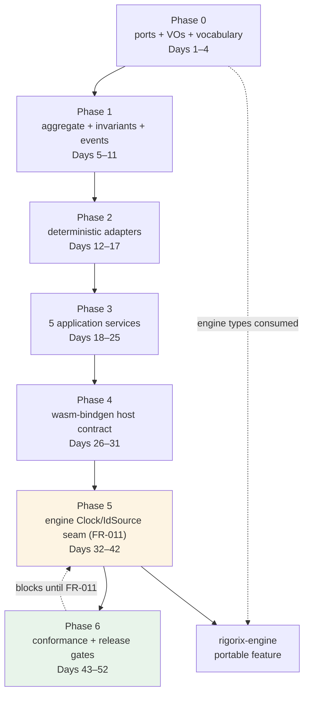

# Implementation Roadmap

<!--
@canonical .pi/architecture/implementation-roadmap.md
Status: Proposed
Date: 2026-11-03
Session: 3baf6e5c-e352-4127-af09-a5e7fe0a2d29
Module: .pi/architecture/modules/portable-session.md (tactical, core)
-->

## Overview

One bounded context (`Portable Session`), one crate (`rigorix-gate-wasm`), four layers. Phases
follow the dependency chain the module doc declares, preceded by three prerequisites: a
feasibility spike (P1), the engine's determinism seam (P2/FR-011) and workspace registration
(P3/ADR-011). See `modules/portable-session.md#prerequisites` for the state of each.

Three constraints shape the order:

- **FR-011 no longer blocks FR-007, and the seam it described does not exist (ADR-014, #1366).**
  Determinism is one operation plus `PinnedInputs`, proven byte-identical from both runtimes
  (#1355). What remains is Phase 5's **Phase C**: `EngineGate` evaluating the real envelope and
  conformance reporting `gate: "cli"`. Criteria 19–22 are restated against that, and
  `normalised_comparison=true` is **forbidden** rather than labelled — see the module doc and
  `wasm/ci/run-conformance.sh`, which now refuses it (#1367).
- **The spike precedes the crate.** Phase -1 proves the engine slice compiles to wasm and
  that one envelope matches, before Phase 0 commits four days.
- **No phase ships a green build that hides a red claim.** A normalised comparison is a
  labelled interim (FR-012), displayed as such, and deleted — not relaxed — when FR-011
  lands.

**There are no database migrations in this project** (ADR-002). The sections are kept for
format consistency and state the fact explicitly rather than being deleted silently.

---

## Phase -1: Feasibility Spike (Days 0–10, may fail cheaply)

**Goal:** prove the crate is buildable before anything is built. Three assertions, one branch:

1. `rigorix-engine`'s gate slice compiles to `wasm32-unknown-unknown` behind the additive,
   non-default `portable` feature, with no fs/network/thread dependency on the exercised path.
2. A pinned clock and id sequence produce the same envelope bytes twice on the CLI.
3. One envelope's bytes are identical between the CLI build and the wasm build.

**Why it is phase -1 and not phase 5:** the engine has 292 `Utc::now()` call sites and 37
`Uuid::new_v4()` in the gate modules (measured). Building four phases first and discovering
the slice does not compile would spend a month to learn what ten days can tell.

**Exit:** bytes match, or the architecture changes here. A failed spike is a successful
phase — it is the cheapest possible discovery of the constraint that matters.

**Recorded outcome (#1366): branch D — all four measurements hold.** The spike ran as `#1351` and
its report is `docs/spike-portable-slice-2026-11.md`; the decision it produced is
`decisions/ADR-014-portable-slice-and-pinned-inputs.md`. `portable` compiles the slice for `wasm32`
(74 crates, no forbidden crate), both runtimes produce `c47b27f9…` for one pinned refusal, and the
shipped engine-linked bundle is 78.0 % of the ceiling. The one assertion it did not reach is
assertion 3 above — the crate's gate does not yet *evaluate* the engine envelope — and that is
Phase 5's remaining work, not the spike's failure.

See `decisions/ADR-009-conformance-harness.md#prerequisite-ordering`.

---

## Phase 0: Capability Surface and Value Objects (Days 11–14)

**Goal:** Fix the six ports, the sealed value objects and the refusal vocabulary so no
later code can invent an ambient capability or a new verdict shape.

### Modules

| Module | Deliverables | Architecture Doc |
|--------|-------------|------------------|
| Portable Session (domain) | `ports/` (Clock, IdSource, Randomness, KeySource, ProviderTransport, BusinessSink), `PortFailure`, `PortId` | `.pi/architecture/modules/portable-session.md#domain-layer-domain` |
| Portable Session (domain) | `ScenarioRef`, `FixtureWorld`, `ClockReading`, `RandomSeed`, `KeyRef`, `GateAttemptId`, `ReplaySessionId`, `Digest` (derived, never random) | same, `#value-objects-entity-vs-vo-justification` |
| Portable Session (domain) | `RefusalVocabulary` (exhaustive engine-kind → business wording) | same, `#domain-services--application-services--infrastructure-services` |
| Portable Session (domain) | `StepOutcome`, `RunOutcome`, `EvidenceRef`, `VerificationResult` (three-valued) | same, `#aggregates` |

### Workspace Registration (ADR-011)

- [x] `wasm/` is in `[workspace] members`; `wasm/Cargo.toml` inherits lints.
      *Proof:* `Cargo.toml:2` lists `wasm`; `wasm/Cargo.toml` now carries `[lints] workspace = true`
      and `unsafe_code = "forbid"` at the crate root (`src/lib.rs`).
      **This was false when first checked**: the manifest declared a local `[lints.rust]` block with
      no `workspace = true`, which silently opts out of *every* workspace lint — this crate was the
      only member doing that, so `clippy::disallowed_types` (clippy.toml, #1083) never applied here
      while ADR-011 claimed it did. Proven fixed: a seeded `std::process::Command` is now denied by
      `disallowed-types`, and a seeded `unsafe` block is still denied by `forbid(unsafe_code)`.
      `edition`/`license` remain literals with the same values as `[workspace.package]` — equal by
      value, not inherited; recorded rather than claimed as inheritance.
- [x] `release.yml` tag loop names `wasm` (the directory, matching the loop's convention);
      `publish-wasm` publishes `rigorix-gate-wasm` to crates.io; `publish-wasm-npm` plus
      `.github/scripts/publish-npm-package.sh` register the host-facing `rigorix-gate`.
- [x] `.pi/panic-baseline.tsv` covers the new crate.
      *Proof:* the scanner walks this tree and reports per-file. Seeding
      `let x: Option<u32> = None; x.unwrap()` into `wasm/src/lib.rs` makes
      `panic_audit.py` report `wasm/src/lib.rs`; with the tree as committed it reports 0 wasm sites.
      The baseline therefore holds **0 rows** for this crate because it has 0 sites — the deny-lints
      in `src/lib.rs` keep it at zero — not because the crate is unscanned.
- [x] `.pi/scripts/validate-release-train.sh` derives the four points above from
      `cargo metadata`, so the next member cannot join the workspace and miss the train
      the way `rigorix-actions` did (#1346).

The npm *publication* is not done and is not claimed here: `publish-wasm-npm` sits outside
`github-release.needs`. The packaging gap that used to block it is closed — the export layer and the
measured size budget landed in #1349, `state: shipped` — so what remains is the publication job
itself, not the artifact. Criterion 24 stays unmet until a tag produces the
package; flipping that state requires wiring the job into `needs` on the same commit, which
the guard enforces.

### Dependencies

- None. (Engine types are consumed read-only; no engine change needed yet.)

### Database Migrations

- None — in-memory only (ADR-002).

### Acceptance Criteria

- [x] `domain_isolation` gate exists and fails on `std::time`, `std::env`, `Uuid::new_v4`, `reqwest`, `rand::thread_rng`, or any `infrastructure`/`interfaces` path.
      *Proof:* `ci/check-domain-isolation.sh:24-45` (13 capability needles + 3 outward needles, fail-closed
      when `src/domain/` is absent). Seeded `std::time::Instant::now()` + `Uuid::new_v4()` into
      `src/domain/value/digest.rs` ⇒ exit 1 naming both; clean ⇒ exit 0. It is a gate script, not a
      `#[test]`, and runs as a mandatory wasm gate.
- [x] `RefusalVocabulary` is an exhaustive match: adding an engine refusal kind without wording is a compile error (AC 8).
      *Proof:* `src/domain/services/business_wording.rs:33-49` — 13 `RefusalKind` variants, 13 arms, no
      wildcard. Seeded a 14th variant (`ProbeUnworded`) ⇒ `error[E0004]: non-exhaustive patterns`.
- [ ] `VerificationResult` has exactly three variants; `reason` exists only on `Unverifiable` (AC 12).
      **Superseded by ADR-013, and must not be implemented here.** There is no such type in `src/`
      (checked: `grep -rni verification src/` returns only comments saying it is absent), because the
      producer may not verify its own record. The three-valued verdict lives in the host:
      `tests/host_verification/verify.mjs:24-28` defines `verified` / `not_verified` / `unverifiable`
      with `unverifiable` carrying a reason, and the gate proves the mapping — the 10th wasm gate
      prints `{"verdict":"unverifiable","reason":"key_not_held"}` and exits 2.
- [x] `ReplaySessionId` is derived from (scenario digest, fixture digest, seed): two identical inputs ⇒ identical id (AC 2).
      *Proof:* `src/domain/value/ids.rs:32-39` (domain separator + the three digests);
      tests `determinism::the_same_inputs_derive_the_same_session_identity` and
      `determinism::a_different_seed_derives_a_different_identity`.

---

## Phase 1: Aggregate, Invariants and Events (Days 15–21)

**Goal:** `ReplaySession` enforces the eight exploration invariants with behaviour methods
and no setters.

### Modules

| Module | Deliverables | Architecture Doc |
|--------|-------------|------------------|
| Portable Session (domain) | `ReplaySession::{open, attempt, seal, take_events}`; `GateAttempt`; `Repository` trait in `domain/` | `#replaysession` |
| Portable Session (domain) | `events::DomainEvent` with evidence/telemetry classification; `EvidenceProjection`; `ArtifactStamp` | `#domain-events` |
| Portable Session (domain) | `errors::{SessionOpenError, AttemptError, SealError}` (exhaustive, redacted) | `#error-handling` |

### Dependencies

- Phase 0.

### Database Migrations

- None — the repository's shipped adapter is in memory; the trait exists so the aggregate is reconstitutable for verification (ADR-002).

### Acceptance Criteria

- [x] FR-001: unparseable scenario or incomplete fixture ⇒ typed `SessionOpenError`, no default, no panic (AC 1).
      *Proof:* typed error in `src/domain/errors/session_open.rs`; tests
      `replaysession::open_refuses_instead_of_defaulting`,
      `wasmcontract::open_session_refuses_unpinnable_input`,
      `attemptrun::the_open_service_refuses_the_same_way_the_aggregate_does`; deny-lints in
      `src/lib.rs` make a panic on this path a build failure.
- [x] Invariant 4: second `attempt` ⇒ `AlreadyAttempted`; second `seal` ⇒ `AlreadySealed` (AC 3, AC 6).
      *Proof:* tests `replaysession_attempt::a_second_attempt_is_refused_and_the_first_outcome_is_unchanged`
      and `replaysession_seal::seal_returns_a_stamped_container_and_refuses_the_second_call`;
      error variants in `src/domain/errors/{attempt,seal}.rs`.
- [x] FR-002: no `RunOutcome` reports `refused` without naming the causing step (AC 10).
      *Proof:* `StepOutcome::causing_step()` on `Refusal`; tests
      `replaysession_attempt::a_refused_run_always_names_its_causing_step` and
      `…::a_refused_run_names_the_causing_step_and_preserves_not_reached`; the 24-case fault matrix
      asserts a cause on every case.
- [x] FR-004: identity-port failure yields engine status `unverified`; no message contains `unauthenticated` (AC 5).
      *Proof:* `RefusalKind::IdentityUnverified` → *"the identity could not be checked"*
      (`src/domain/services/business_wording.rs:45`); test
      `refusalvocabulary` forbids `["unauthenticated", "not_verified", "unverifiable", "forged"]`
      in every rendered string (`refusalvocabulary_test.rs:77`), plus a source-level scan at :176.
- [x] `not_reached` is preserved as a distinct `StepOutcome` decision (AC 9).
      *Proof:* `StepOutcome::NotReached` in `src/domain/outcome/step_outcome.rs`; tests
      `evidenceprojection::not_reached_is_distinct_from_refused` and
      `…::the_shipped_projection_preserves_order_and_not_reached`.
- [x] `RandomDrawConsumed` cannot reach `ArtifactSet` (AC 17).
      *Proof:* three tests in `tests/unit/portable-session/telemetryobserver/`:
      `a_random_draw_is_telemetry_and_never_evidence`,
      `an_artifact_set_has_no_slot_for_an_event_at_all` (the type has no field that could hold one —
      this is the structural half, and it is what makes the property unbreakable rather than
      merely tested), `telemetry_is_dropped_from_a_release_build_by_construction`.
      *Note:* the criterion names a test `telemetry_never_reaches_artifact_set`; no test carries that
      name. The property is checked, the name is not — recorded rather than renamed to fit the doc.
- [ ] Domain coverage ≥95%.
      **Measured 91.62 % lines** (585 lines, 49 missed) / 89.52 % regions —
      `cargo llvm-cov -p rigorix-gate-wasm --test unit --summary-only --ignore-filename-regex 'src/(application|interfaces|infrastructure)/'`,
      2026-11-03. The earlier figure in this line was **89.52 %, which is the regions
      column**, not lines (#1348). Gated as a ratchet at 91.62 % lines
      (`.pi/coverage-layers.tsv`, `coverage.sh --gate-layers`), so it cannot regress;
      the 3.38 pp to the criterion is a gap, not a pass.

---

## Phase 2: Deterministic Adapters and Fail-Closed Paths (Days 22–27)

**Goal:** Every port answers from a fixture transcript or fails with a typed failure —
never a default.

### Modules

| Module | Deliverables | Architecture Doc |
|--------|-------------|------------------|
| Portable Session (infra) | `FixtureClock`, `SeededIdSource`, `FixtureRandomness`, `SeededKeySource`, `HostKeySource` | `#infrastructure-layer-infrastructure` |
| Portable Session (infra) | `FixtureProviderTransport` (no network), `FixtureBusinessSink` (no I/O) — no session store (ADR-002) | same |
| Portable Session (infra) | `CanonicalSerializer` wrapper (never re-encodes envelopes) | same |

### Dependencies

- Phase 1.

### Database Migrations

- None.

### Acceptance Criteria

- [x] Fault matrix: for each of six ports × {missing, exhausted, malformed, failed}, `attempt` returns `refused` in 100% of cases and `allowed` in 0% (AC 4, NFR-004).
      *Proof:* `tests/unit/portable-session/replaysession-attempt/replaysession-attempt_test.rs:231-302`,
      `the_full_fault_matrix_refuses_every_case`: 6 `PortId` × 4 `PortFailureKind`, asserts
      `cases == 24` and `allowed.is_empty()`.
- [x] `cargo tree --target wasm32-unknown-unknown` contains no `tokio`, `reqwest`, `tree-sitter*`, `prometheus`, `tracing-appender`, `libc` (NFR-002).
      *Proof:* `cargo tree --target wasm32-unknown-unknown -p rigorix-gate-wasm` = 27 crates (the six over the earlier 21 are the export layer: `wasm-bindgen`, `-macro`, `-macro-support`, `-shared`)
      (serde, serde_json, sha2/digest chain, thiserror, …); none of the banned names appear.
- [ ] `KeySource` adapters return only an opaque `KeyRef`; no key bytes reach any output (AC 7).
      **Type is opaque; the "no bytes" half has no test.**
      `src/domain/value/key.rs:19` — `pub struct KeyRef(String)`, constructible only via
      `from_trusted`; the exported artifact carries it via
      `export_stamp::an_artifact_set_carries_both_digests_and_an_opaque_key_ref`. But `KeyRef` wraps
      a `String` and no test asserts that a `SeededKeySource`'s material never appears in the
      serialized output — the property rests on adapter discipline, not on a check.
- [x] Two runs over the same transcript produce byte-identical clock/ids/draws (NFR-001).
      *Proof:* tests `determinism::the_same_vector_replays_to_the_same_bytes_twice_in_one_instance`,
      `…::a_fresh_process_produces_the_same_bytes_as_this_one` (a second OS process),
      `…::no_source_file_reaches_a_real_clock_or_entropy_source`,
      `runconformancevector::replaying_the_same_vector_twice_produces_identical_bytes`.

---

## Phase 3: Application Services (Days 28–35)

**Goal:** The five catalog services orchestrate aggregate + ports without holding a rule
of their own.

### Modules

| Module | Deliverables | Architecture Doc |
|--------|-------------|------------------|
| Portable Session (app) | `OpenReplaySession`, `AttemptRun` (FR-001/2/3/4/9/11/13) | `#application-services-from-exploration-use-cases` |
| Portable Session (app) | `ExportArtifactSet` + `ContentScanner` (FR-005/010/014) | same |
| Portable Session (app) | host-side verification: the crate exports, the host checks with `rigorix-verifier` (ADR-013, FR-006) | — |
| Portable Session (app) | `ArtifactQuery` read helper | `#application-layer-application` |

### Dependencies

- Phase 2 (all six adapters usable).

### Database Migrations

- None.

### Acceptance Criteria

- [ ] Artifact stamps carry `artifact_format_version`, `engine_version` (from `ENGINE_VERSION`), scenario digest, fixture digest, `outcome_digest` (AC 11).
      **All five facts are present; `engine_version` is not from `ENGINE_VERSION`.**
      Fields: `src/domain/artifact/version_stamp.rs:23-25`; proof of all five in
      `replaysession_seal::the_stamp_carries_the_five_facts_criterion_11_asks_for`. That test asserts
      `engine_version == env!("CARGO_PKG_VERSION")`, with a comment that it becomes the engine's
      constant once FR-011 lands — so today the number is right by coincidence (both 1.12.1) and the
      stated source is not.
- [ ] Unknown format version ⇒ `unverifiable(UnsupportedFormatVersion)`; never `not_verified`, never a thrown error (AC 12).
      **Superseded by ADR-013 and deliberately not implemented as written.** The crate cannot emit a
      verdict: it exposes a shape question, `ArtifactSet::supports(version) -> bool`
      (`src/domain/artifact/artifact_set.rs:60`). Tests
      `export_stamp::an_unknown_format_is_identifiable_without_any_verdict_from_the_crate` and
      `…::the_crate_never_emits_the_hosts_verdict_vocabulary`. The host maps `false` to
      `unverifiable` — proven in the host harness, not here.
- [x] Pre-export scan refuses (does not sanitise) on secret/key/path/PII; bytes of a rejected set never leave (AC 7).
      *Proof:* `src/infrastructure/content_policy.rs` (`ScanningContentPolicy`) consulted by `seal`;
      tests `replaysession_seal::a_violated_content_rule_refuses_the_export_and_drops_the_bytes`,
      `…::an_envelope_carrying_a_host_path_is_refused_at_export`,
      `…::our_own_policy_would_catch_a_path_in_the_metadata_too`,
      `attemptrun::the_export_service_refuses_a_rejected_content_rule`.
- [x] The crate contains no verification logic and no verifier dependency; the bundle's dependency tree is clean (ADR-013, AC 14).
      *Proof:* no `verifier` in `wasm/Cargo.toml`; `cargo tree --target wasm32-unknown-unknown` (21
      crates) contains none; the `bundle independence` wasm gate enforces it and the host harness
      imports only `rigorix-verifier` (`tests/host_verification/verify.mjs:6-8`).
- [x] Application coverage ≥90%.
      **Measured 93.49 % lines** (169 lines, 11 missed) / 89.64 % regions — the earlier
      figure here was the **regions** column, so this criterion was recorded as unmet
      while it meets its stated threshold on the metric it is written against (#1348).
      Gated as a ratchet at 93.49 % lines (`.pi/coverage-layers.tsv`), 3.49 pp above the
      criterion. Functions are at 73.33 %, with `run_conformance_vector.rs` at 57.89 %.

---

## Phase 4: Host Contract (Days 36–41)

**Goal:** Publish the five-function wasm-bindgen surface that makes misuse impossible.

### Modules

| Module | Deliverables | Architecture Doc |
|--------|-------------|------------------|
| Portable Session (interfaces) | `WasmContract` (`open_session`, `attempt_run`, `export_artifact_set`, `verify_artifact_set`, `contract_version`) | `#api-endpoints` |
| Portable Session (interfaces) | `dto::*` with `deny_unknown_fields` + golden snapshots; `DtoMapper`; `RefusalDto` | same |
| Portable Session (interfaces) | `TelemetryObserver` (release-compiled-out) | same |

### Dependencies

- Phase 3.

### Database Migrations

- None.

### Acceptance Criteria

- [x] No exported function accepts a verdict, `allow` flag or policy override (AC 15, FR-009).
      *Proof:* tests `wasmcontract::no_dto_carries_a_verdict_shaped_field` and
      `attemptrun::execute_has_no_way_to_ask_for_an_allow`; the four signatures in
      `src/interfaces/wasm_api.rs` take only scenario/fixture/action inputs.
- [x] Unknown DTO fields rejected; malformed handle is the only thrown error; every refusal is a return value (AC 16).
      *Proof:* `#[serde(deny_unknown_fields)]` on the input DTOs in `src/interfaces/dto/`; tests
      `wasmcontract::unknown_dto_fields_are_refusals_not_ignored`,
      `…::unknown_fields_are_rejected_not_ignored`,
      `…::a_refusal_is_a_return_value_and_the_only_error_is_a_bad_handle`,
      `…::refusal_shape_is_redacted`.
- [x] A host can load the module and round-trip all four functions (AC 13; the host-side independence check is Phase 6).
      *Proof:* `src/interfaces/wasm_api.rs` carries the `#[wasm_bindgen]` export layer (`pub mod exported`,
      wasm32 only), and `ci/run-module-smoke.sh` packages the release artifact with `wasm-bindgen
      --target nodejs`, loads it in Node and calls all four: `contract_version` reports the three
      numbers, `open_session` returns `gate:sha256:…`, `attempt_run` on the unlinked seam returns
      `kind: "gate_unavailable"` as a *value*, `export_artifact_set` before an attempt is the
      `seal_failed` refusal, and a malformed handle is the one throw (#1349). The gate fails on a
      missing export, an unannounced fifth export, an instantiation error or a wrong return value —
      seeded by deleting one attribute, which fails it by name. Before this, every gate passed on a
      368-byte module with no exported symbol.
- [x] `contract_version` matches the published semver (ADR-004).
      *Proof:* `src/interfaces/wasm_api.rs:249-255` builds all three numbers from
      `env!("CARGO_PKG_VERSION")`, `EngineArtifactStamp::engine_version()` and
      `ArtifactSet::FORMAT_VERSION`; test
      `wasmcontract::export_before_an_attempt_is_a_refusal_and_contract_version_reports_three_numbers`.
      Crate version is 1.12.1 (`wasm/Cargo.toml:3`), equal to the train.
- [ ] Interface coverage ≥85%.
      **Measured 74.47 % lines** (329 lines, 84 missed) / 75.68 % regions —
      `--ignore-filename-regex 'src/(domain|application|infrastructure)/'`, 2026-11-03.
      Gated as a ratchet at 74.47 % lines (`.pi/coverage-layers.tsv`); the 10.53 pp to the
      criterion is a gap. Per file: `wasm_api.rs` 65.48 %, `registry.rs` 79.49 %,
      `errors.rs` 71.83 % (lines).

---

## Phase 5: EngineGate wiring — what remains of FR-011 (Days 11–14, no longer parallel)

> **Superseded in scope by ADR-014 (#1366).** The phase was 31 parallel days for a crate-wide
> `Clock` + `IdSource` seam. The spike measured that away: one operation needs one pinned site,
> and #1355 reached byte identity with it (`c47b27f9…`, pinned by a test). What remains is
> **Phase C**: wire `EngineGate` to the real envelope, flip conformance to `gate: "cli"`, and
> regenerate goldens from the same-commit CLI.

**Goal:** prove the crate's central claim in the crate's own build — the wasm gate evaluates the
real envelope and produces the bytes the CLI produces, with conformance reporting `gate: "cli"`
rather than `fixture`.

### Modules

| Module | Deliverables | Architecture Doc |
|--------|-------------|------------------|
| rigorix-engine (additive features) | **Superseded by ADR-014 for the determinism seam:** `PinnedInputs` + the additive `with_pinned_inputs` behind the non-default `portable` feature, with the pin applied inside one shared operation (`audit::application::pinned`). No `Clock`/`IdSource` trait pair on the gate path — one operation, one site; those ports belong to `portable-session`'s domain when a second consumer exists | `engine/src/audit/application/`, gate modules; `.pi/architecture/decisions/ADR-014-portable-slice-and-pinned-inputs.md` |
| rigorix-cli (non-default feature) | `--pinned-clock`, `--pinned-ids` so the oracle can be given the same inputs | cli |
| rigorix-gate-wasm | **Phase C**: `EngineGate` calls the real envelope instead of `SeamGate::not_linked()`; conformance flips to `gate: "cli"`; goldens regenerated from the same-commit CLI | this module |

### Dependencies

- Phase -1 (the spike, done: `docs/spike-portable-slice-2026-11.md`) and Phase 4 (the host
  contract the gate produces for). No longer parallel with 0–4: the seam it waited on was
  removed by ADR-014, so this phase consumes an existing engine operation rather than building
  one.

### Database Migrations

- None.

### Acceptance Criteria

- [x] **Superseded (#1366): the 292-site / 37-site inventory is void.** It was the cost estimate
      for a crate-wide seam that ADR-014 removed. The determinism path is one operation
      (`audit::application::pinned::refusal_envelope_input`) and one pinned site, measured and
      pinned by `tests/unit/pinnedinputs::the_documented_pins_produce_the_golden_digest`.
- [ ] `EngineGate` evaluates the real envelope: a vector's bytes from the wasm module equal the
      same commit's CLI bytes, and conformance reports `gate: "cli"` for them.
      **Phase C, not started.** Until it lands, ADR-014's three `no, yet` rows (engine-linked
      bundle, `name`-section size, `wasm32` crate count) cannot be stated as facts about `main`.
- [x] Default-feature suites of engine, mcp, cli, actions pass unchanged from the same commit (NFR-005).
      *Proof:* the CI `test` stage is green on this branch for all four crates, and locally
      `cargo test -p rigorix-engine --lib` (and cli/mcp/actions/server) pass. **Currently vacuous** —
      no engine-side change has been made, so nothing could break. It becomes a real check the moment
      FR-011 lands.
- [x] CLI built from the same commit accepts pinned clock/ids and produces the same envelopes twice (NFR-001).
      *Proof (#1355):* `rigorix pinned-refusal --pinned-clock 2026-11-03T12:00:00Z --pinned-ids
      018f5b8e-0000-7000-8000-000000000001` and the in-crate example both print `c47b27f9…` at 853 B.
      **Not implemented.** `grep -rn 'pinned|--clock|--seed|--ids' cli/src` returns nothing: the CLI has
      no flag for a pinned clock or identifier sequence, so NFR-001 can only be exercised inside this
      crate (`determinism::a_fresh_process_produces_the_same_bytes_as_this_one`), not across the CLI.
- [ ] `cargo tree` diff for the wasm target shows no new native-only dependency (NFR-002).
      **Cannot be evaluated.** A diff needs a before/after pair, and there is no seam to add: with the
      `engine` feature empty, the "after" tree is the "before" tree. The static half is satisfied —
      the current tree (27 crates, including the export layer) carries no native-only dependency.

---

## Phase 6: Conformance Harness and Release Gates (Days 42–51)

**Goal:** Prove byte identity against the CLI, prove the comparator can fail, and gate the
release train.

### Modules

| Module | Deliverables | Architecture Doc |
|--------|-------------|------------------|
| Portable Session (test tree) | `RunConformanceVector` (test feature only), golden vectors, live CLI diff job | `#application-services-from-exploration-use-cases` |
| Portable Session (test tree) | `seeded_divergence` must-fail test (FR-008) | same |
| CI | size budget gate, dependency ban list, PII scanner, `domain_isolation`, npm version pin | ADR-009, NFR-002, NFR-005 |

### Dependencies

- Phase 5. **FR-007 cannot pass before this phase completes.**

### Database Migrations

- None.

### Acceptance Criteria

- [ ] Live CLI diff: byte-identical artifacts for every vector; any difference fails the build (AC 19, FR-007).
      **Not implemented, blocked on FR-011.** `ci/run-conformance.sh` replays the committed vector and
      compares it to the committed expectation; nothing invokes the CLI. Blocked for the same reason
      criterion 19 is: the CLI cannot be given the crate's clock/ids.
- [ ] Committed goldens match; a stale golden fails the live diff instead of being silently regenerated (AC 20).
      **Half met.** A stale golden does fail: `runconformancevector::a_matching_vector_passes_and_a_mutated_expected_fails`
      shows a mutated expectation failing the run, and nothing regenerates the vector automatically. But
      the criterion is about the *live diff*, which does not exist — see AC 19.
- [x] `seeded_divergence` diverges as required; if the comparator reports equality the build fails (AC 21, FR-008).
      *Proof:* `tests/unit/portable-session/seeded-divergence/` — six tests including
      `a_seeded_vector_that_starts_matching_fails_the_build` and `equality_on_the_seeded_vector_is_a_failure`;
      enforced by `ci/run-conformance.sh`, which fails the `conformance` wasm gate.
- [x] A skipped or missing vector fails the run, and `normalised_comparison: true` is **refused**
      rather than labelled (AC 22; the permission was withdrawn with FR-011, #1367).
      *Proof:* `runconformancevector::a_skip_is_a_failure_never_a_pass`,
      `…::an_unreplayable_vector_is_a_skip_and_a_skip_is_a_failure`,
      `…::a_normalised_comparison_is_never_a_pass`, `…::a_report_never_claims_a_normalised_comparison`,
      and `ci/run-conformance.sh`, which fails a vector carrying the flag and names it.
      The shipped report sets `normalised_comparison: false` (`run_conformance_vector.rs:152`) — byte
      comparison today, no interim flag in use.
- [ ] Browser-produced artifact set verifies under `rigorix-verifier` with no shared code (AC 13, FR-006).
      **Independence is proven; the browser is not.** `tests/host_verification/verify.mjs` uses
      `rigorix-verifier@0.9.0` alone (`verifySignature`, `validateEnvelope`, `verifyChain`) and imports
      nothing from this crate; `ci/run-host-verification.sh` runs it in a separate Node process as the
      10th gate, printing `unverifiable(key_not_held)` with exit 2 — the three-valued contract. What is
      missing is a *browser*: the bundle the smoke gate packages is `--target nodejs` (#1349), so the
      environment it runs in is still Node.
- [ ] Bundle within measured budget +25%; npm version equals `rigorix-engine` version (AC 23, AC 24).
      **The ceiling is in force on the shipped artifact; the publication is not.** `ci/bundle-budget.txt`
      states `state: packaged` with `measured_bytes: 209881` / `budget_bytes: 262351` (measured + 25 %).
      The subject changed in #1353: `wasm-bindgen` emits 243 366 B, of which **33 485 B (13.8 %) is the
      `name` custom section** — the debug symbol table, which no host reads — so `ci/strip_name_section.py`
      strips it in the packaging path and the number above is what a host actually loads. Two assertions,
      both required: the artifact carries no `name` section (size alone cannot prove the strip ran — an
      unstripped 243 366 B file sits under a 262 351 B budget) and it is within budget. The npm half stays
      unmet: no version has been published, and `publish-wasm-npm` remains outside `github-release.needs`
      until a tag produces the package.

---

## Dependency Graph

## Effort Estimates

| Phase | Days | Primary risk | Mitigation |
|-------|------|--------------|------------|
| -1 — Feasibility spike | 10 | The engine slice does not compile to wasm, or the bytes never match | Prove it before Phase 0; a failed spike is a successful phase |
| 0 — Ports & VOs | 4 | Vocabulary drift from the engine's refusal kinds | Exhaustive match; engine kinds imported, not copied |
| 1 — Aggregate | 7 | An invariant that only holds in tests | Each invariant has an illegal-state test; no setters to bypass |
| 2 — Adapters | 6 | An adapter that silently defaults | Fault matrix over 6 ports × 4 failure kinds |
| 3 — App services | 8 | A rule leaking into orchestration | Architecture test + review against ADR-007 |
| 4 — Host contract | 6 | DTO drift, panic across FFI | Golden DTO snapshots; fault matrix at the boundary |
| 5 — EngineGate wiring (Phase C) | 4 | A gate that "evaluates" without the real envelope | Conformance reports `gate: "cli"` only when the bytes came from the CLI; goldens regenerate from the same commit |
| 6 — Conformance | 10 | A comparator that cannot fail | Seeded divergence is a required negative test |
| **Total** | **55** (45 after the spike) | the sum of this column: 10+4+7+6+8+6+4+10 — recomputed after ADR-014 removed the 31-day seam (#1366) | |

## Key Milestones

| Milestone | Exit condition | Phase |
|-----------|----------------|-------|
| M1 — Capability surface frozen | Six ports compile; `domain_isolation` green | 0 |
| M2 — Invariants enforced | All eight invariant tests green; zero setters | 1 |
| M3 — Fail-closed proven | Fault matrix: 0 allows across 24 failure cases | 2 |
| M4 — Host contract live | Five functions callable from node; refusals are return values | 4 |
| M5 — Determinism owned by the engine | CLI accepts pinned clock/ids; four published crates unchanged | 5 |
| M6 — Byte identity proven | Live diff green + seeded divergence red + verifier independence green | 6 |
| M7 — Release | npm published at engine version; size gate green | 6 |

## Out of Scope (explicit)

- No persistence, no migrations, no server, no HTTP API (ADR-002, ADR-004).
- No cost tracking or metering (ADR-006).
- No compliance judgement, no reporting surface (ADR-007).
- No reimplementation of engine logic in Rust-for-wasm or in TypeScript.

---

*Last updated: 2026-11-03*