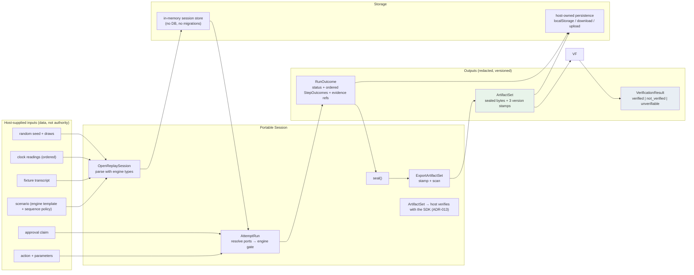
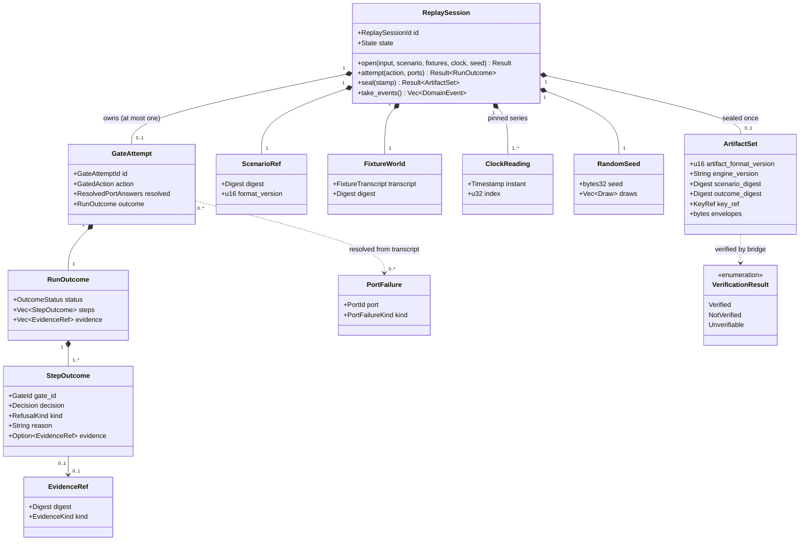
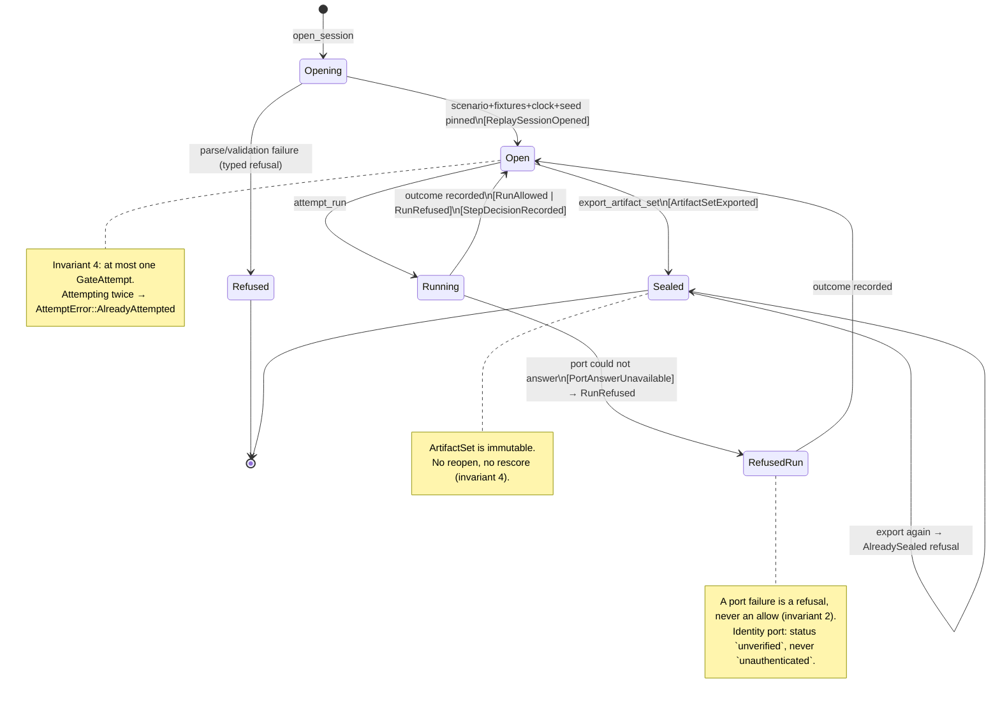
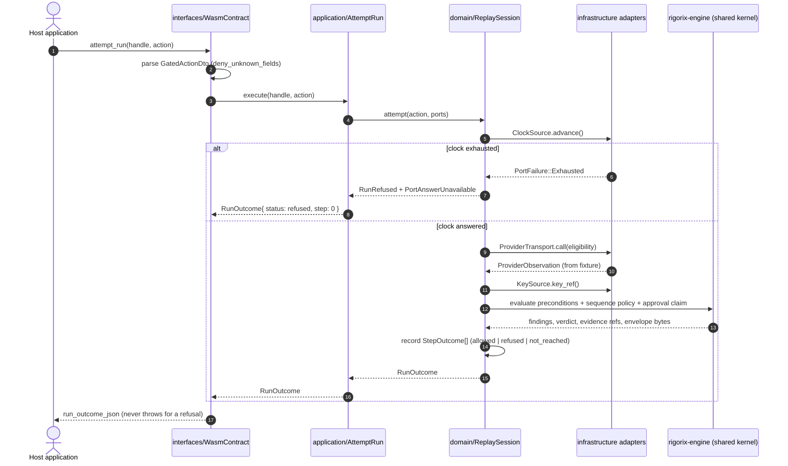

# Portable Session

<!--
Canonical Reference: .pi/architecture/modules/portable-session.md
Module depth: tactical (core domain) — see ADR-008
-->

## Module Status

**Status:** Contract frozen (#1294) — behaviour pending per component
**Last reviewed:** 2026-11-03
**Source session:** 3baf6e5c-e352-4127-af09-a5e7fe0a2d29

## Description

The determinism seam: one run lifecycle bound to an engine scenario reference, a host-supplied fixture world and explicit port readings, replayable to identical artifact bytes. This is the only domain the crate owns. Modules it decomposes into: domain / application / interfaces (the published host contract and the wasm-bindgen surface) / infrastructure (the five deterministic adapters and the verifier bridge). Conformance is a build-time harness, not a context.


**Modeling Depth:** tactical (core domain)
**Subdomain Rationale:** The replayable, byte-identical gate is the crate's reason to exist and the only place it makes a decision; everything else composes engine logic behind ports. It is core rather than supporting because its correctness — determinism, evidence integrity, three-valued verification — is exactly what a host sells.
**Context Map:** shared-kernel → rigorix-engine (Consumes the engine's gate, policy evaluation, envelope format and signing. Re-models nothing.); conformist → rigorix-verifier (Outbound only, through the bridge. The verifier shares no code with this crate; the artifact format is the whole contract.); conformance-oracle → rigorix-cli (The CLI built from the same commit is the oracle for byte-identical artifacts.); Host application → customer-supplier (The host supplies fixtures and consumes RunOutcome, ArtifactSet and VerificationResult. The contract is versioned.)

## Modeling Depth Note (ADR-008)

`Portable Session` is a **core** subdomain and therefore modeled at **tactical** depth:
the aggregate is a real consistency boundary carrying the eight exploration invariants,
behaviour lives on the root (no setters), value objects justify entity-vs-VO status,
domain events carry payloads and triage flags, and the repository interface is owned by
`domain/`. Delivery-shaped concerns stay thin: the verifier bridge is an
anti-corruption layer, the conformance harness is a build-time test tree that never
enters the bundle, and the five deterministic adapters are plain structs behind ports
the *engine* declares. Nothing here is abstracted speculatively — a trait exists because
the engine requires it or because a second variant is already known (memory vs seeded
key source; memory vs test-file session store).

## Related ADRs

| ADR | Title | Relevance to this module |
|-----|-------|--------------------------|
| [ADR-001](../decisions/ADR-001-architecture-pattern.md) | Layered single-crate seam | Why there is one context and four layers, and how the direction is enforced |
| [ADR-002](../decisions/ADR-002-data-storage.md) | No persistence; artifact set is durable state | Why `SessionStore` has an in-memory adapter and why there are no migrations |
| [ADR-003](../decisions/ADR-003-cross-context-events.md) | In-process events; evidence vs telemetry | Which of the seven events may enter a signed artifact |
| [ADR-004](../decisions/ADR-004-api-design.md) | Host contract = wasm-bindgen + JSON DTOs | The four exported functions and the three version numbers |
| [ADR-005](../decisions/ADR-005-authentication.md) | No principal; key ownership + capability-free surface | `KeySource` port, `key_ref`, approval-as-claim |
| [ADR-006](../decisions/ADR-006-cost-tracking.md) | No cost tracking or metering in-crate | Why the run path holds no counters or wall-clock reads |
| [ADR-007](../decisions/ADR-007-compliance-engine.md) | Execute the gate, do not judge compliance | Vocabularly discipline: allowed/refused/verified/unverifiable only |
| [ADR-008](../decisions/ADR-008-proportional-modeling-depth.md) | Proportional modeling depth | Justifies tactical depth and forbids invented modeling |
| [ADR-009](../decisions/ADR-009-conformance-harness.md) | Conformance harness: live diff + goldens + seeded divergence | How FR-007/FR-008/FR-012 are proven, and that FR-011 blocks FR-007 |
| [ADR-010](../decisions/ADR-010-artifact-format.md) | Artifact set: engine-owned bytes, sealed, stamped, three-valued | The container shape and the `VerificationResult` enum |
| [ADR-011](../decisions/ADR-011-crate-identity-and-release-train.md) | Crate identity, version lockstep, release-train membership | Which crate, which npm name, which manifest fields, which release steps |
| [ADR-012](../decisions/ADR-012-failure-semantics-on-wasm32.md) | Failure semantics on wasm32: abort is not a refusal | What may be promised on the gate path, and what is a fatal host-visible error |
| [ADR-013](../decisions/ADR-013-who-verifies.md) | The crate produces; the host verifies | Four exported functions, no verifier in the bundle, three-valued vocabulary rendered host-side |

## Architecture

This module follows **Domain-Driven Design** with Clean Architecture layers:

| Layer | Responsibility | Path |
|-------|--------------|------|
| **Domain** | Aggregates, entities, value objects, domain services, repository interfaces | wasm/src/domain/ |
| **Application** | Use cases / application services, DTOs, input validation | wasm/src/application/ |
| **Infrastructure** | Port adapter implementations, verifier bridge, sealing/serialization helpers | wasm/src/infrastructure/ |
| **Interfaces** | wasm-bindgen exports, DTO serialization, error projection, telemetry callback | wasm/src/interfaces/ |

Crate paths (real): `wasm/src/{domain,application,infrastructure,interfaces}/`.
Dependency rule: `interfaces → application → domain`, with `infrastructure` implementing
ports declared in `domain`. `domain` may name only `rigorix-engine` types and `core`/
`alloc`/`serde` — enforced by the `domain_isolation` architecture test (ADR-001).

**Application-layer constraint:** this layer never reads the clock, never mints an id,
never touches the network and never writes outside the aggregate's own method calls. It
orchestrates; the engine decides (ADR-006, invariant 1).

**Infrastructure note:** there is no database and no ORM (ADR-002). "DB models" in the
template's sense do not exist here; the adapters implement engine-declared ports and one
in-memory session store.

## Aggregates

### ReplaySession

Aggregate root (identity ReplaySessionId): owns the scenario reference, the fixture-world pin, the pinned clock-reading series, the random seed, at most one GateAttempt, and the sealed ArtifactSet.

**Owned Entities:**
- GateAttempt: One proposed run under evaluation (identity GateAttemptId): carries the action and parameters, the resolved port answers and the RunOutcome. Never reopened or rescored, and it is not a business transaction.

**Value Objects:**
- ArtifactSet: The exported byte sequence: produced envelopes, evidence references, scenario digest, engine version and artifact-format version.

**Repository Interface:**

```rust
pub trait ReplaySessionRepository: Send + Sync {
    async fn find_by_id(&self, id: &ReplaySessionId) -> Result<Option<ReplaySession>, DomainError>;
    async fn save(&self, replaySession: &ReplaySession) -> Result<(), DomainError>;
    async fn delete(&self, id: &ReplaySessionId) -> Result<(), DomainError>;
}
```
**Aggregate Invariants:**
- No ambient capability on the run path: time, entropy, network and filesystem are reachable only through the five ports. (prevents: Two runs of the same session produce different artifact bytes, so a replay cannot be audited or reproduced.)
- Every port answer is read from the session's fixture transcript; missing, exhausted, malformed or failed yields a typed PortFailure that becomes a refusal. (prevents: An unanswered port defaults to allow, and an unavailable check is indistinguishable from a passed one.)
- The host supplies data evaluated by engine policy, never authority: no API, flag or fixture key can express 'allow' or suppress a finding. (prevents: The gate becomes host-controlled and the record stops being evidence of anything.)
- One run per session, sealed at completion with its evidence; neither the outcome nor the artifact set can be reopened or rescored. (prevents: An outcome exists without the evidence that produced it, or evidence is edited after the verdict.)
- Timestamps, identifiers and randomness come only from pinned clock readings, the declared id sequence and the declared seed. (prevents: Nondeterminism enters through a clock read or a fresh UUID, and conformance with the CLI becomes untestable.)
- Verification is three-valued: verified, not_verified (compared and does not match), unverifiable (could not ask — unsupported format, absent key, key not held). 'unverifiable' is never rendered, logged or styled as 'not_verified'. (prevents: A record the host could not check is reported as tampered, or a tampered record is reported as unchecked.)
- Artifacts carry no secrets, no key material, no absolute host paths and no personal data; the key exists only as an opaque reference. (prevents: Key material or a host path leaves in an export that is meant to be shared.)
- Every artifact set is stamped with scenario digest, engine version and artifact-format version; an unsupported version is refused rather than guessed. (prevents: A record whose producer and format are unknown is verified against today's rules and appears sound.)


#### Aggregate stub (`domain/session/replay_session.rs`)

```rust
//! @canonical .pi/architecture/modules/portable-session.md#replaysession
//! @adr ADR-001, ADR-002, ADR-008

use rigorix_engine::templates::TemplateId as EngineScenarioId;

/// Aggregate root. Identity: ReplaySessionId.
/// Behaviour only — no setters, no public fields, no `&mut` access to state.
pub struct ReplaySession {
    id: ReplaySessionId,
    scenario: ScenarioRef,
    fixtures: FixtureWorld,
    clock: ClockTrack,          // pinned series, consumed in order
    seed: RandomSeed,
    attempt: Option<GateAttempt>,   // at most one (invariant 4)
    sealed: Option<ArtifactSet>,    // sealed once (invariant 4)
    events: Vec<DomainEvent>,       // evidence + telemetry, ordered
}

impl ReplaySession {
    /// FR-001: parse with engine types; anything incomplete is a typed refusal.
    pub fn open(
        input: OpenSessionInput,
        scenario: ScenarioRef,
        fixtures: FixtureWorld,
        clock: ClockTrack,
        seed: RandomSeed,
    ) -> Result<Self, SessionOpenError>;

    /// FR-002/FR-003/FR-004/FR-013. One attempt per session.
    /// Returns the outcome; raises evidence events. Never returns Allowed on port failure.
    pub fn attempt(&mut self, action: GatedAction, ports: &dyn PortSet)
        -> Result<RunOutcome, AttemptError>;

    /// FR-005/FR-010/FR-014. Seals and returns the immutable artifact set.
    pub fn seal(&mut self, stamp: VersionStamp) -> Result<ArtifactSet, SealError>;

    /// ADR-003: drain ordered events (evidence vs telemetry classified at the type level).
    pub fn take_events(&mut self) -> Vec<DomainEvent>;

    // Read-only projections used by the export service.
    pub fn scenario_digest(&self) -> &Digest;
    pub fn fixture_digest(&self) -> &Digest;
    pub fn outcome(&self) -> Option<&RunOutcome>;
    pub fn sealed(&self) -> Option<&ArtifactSet>;
}
```

**Behaviour, not data.** `attempt` is the only way state advances; there is no
`set_outcome`, no `set_allowed`, no `&mut` escape hatch (invariant 3). `seal` is
idempotent-refusing: a second call returns `SealError::AlreadySealed` (invariant 4).

#### Entity stub (`domain/session/gate_attempt.rs`)

```rust
pub struct GateAttempt {
    id: GateAttemptId,              // from IdSource port, never Uuid::new_v4
    action: GatedAction,
    resolved: ResolvedPortAnswers,  // what the transcript actually answered
    outcome: RunOutcome,            // set exactly once, inside ReplaySession::attempt
}

impl GateAttempt {
    pub(crate) fn record(id: GateAttemptId, action: GatedAction,
                         resolved: ResolvedPortAnswers, outcome: RunOutcome) -> Self;
}
```

#### Value objects (entity-vs-VO justification)

| Value object | Fields | Justification (identity persists / immutable / equal by state) | Notes |
|---|---|---|---|
| `ReplaySessionId` | digest of (scenario, fixtures, seed) | no / yes / yes | Derived, never random — determinism invariant 5 |
| `GateAttemptId` | index in declared id sequence | no / yes / yes | Comes from `IdSource`, not `Uuid::new_v4` |
| `ScenarioRef` | `digest: Digest`, `format_version: u16` | no / yes / yes | Engine-format pointer, never a re-typed policy (FR-001) |
| `FixtureWorld` | `transcript: FixtureTranscript`, `digest: Digest` | no / yes / yes | Data the policy evaluates, never authority (FR-009) |
| `ClockReading` | `instant: Timestamp`, `index: u32` | no / yes / yes | Only source of time; no `SystemTime` anywhere |
| `RandomSeed` | `seed: [u8; 32]`, `draws: Vec<Draw>` | no / yes / yes | Replayable id/nonce source |
| `PortFailure` | `port: PortId`, `kind: PortFailureKind` | no / yes / yes | Projects to refusal; identity port ⇒ `unverified`, never `unauthenticated` (FR-004) |
| `RunOutcome` | `status`, `steps: Vec<StepOutcome>`, `evidence: Vec<EvidenceRef>` | no / yes / yes | No third shape, no host-settable verdict (FR-002) |
| `StepOutcome` | `gate_id`, `decision`, `kind`, `reason`, `evidence: Option<EvidenceRef>` | no / yes / yes | `not_reached` is a real third decision |
| `EvidenceRef` | `digest: Digest`, `kind: EvidenceKind` | no / yes / yes | Borrowed from the engine, never minted here |
| `ArtifactSet` | version stamps + engine bytes | no / yes / yes | Sealed, self-describing (ADR-010) |
| `VerificationResult` | `Verified` / `NotVerified` / `Unverifiable(reason)` | no / yes / yes | Three-valued (FR-006); reason only on `Unverifiable` |

#### Ports declared by the domain (`domain/ports/`)

```rust
/// The engine declares the need; the domain owns the trait; infrastructure implements it.
pub trait Clock          { fn advance(&mut self) -> Result<ClockReading, PortFailure>; }
pub trait IdSource       { fn next_id(&mut self, kind: IdKind) -> Result<Id, PortFailure>; }
pub trait Randomness     { fn draw(&mut self) -> Result<Draw, PortFailure>; }
pub trait KeySource      { fn key_ref(&self) -> Result<KeyRef, PortFailure>; }
pub trait ProviderTransport {
    fn call(&mut self, call: &ProviderCall) -> Result<ProviderObservation, PortFailure>;
}
pub trait BusinessSink   { fn record(&mut self, write: &SinkWrite) -> Result<(), PortFailure>; }
pub trait ReplaySessionRepository { /* see above */ }
```

#### Repository interface ownership

`ReplaySessionRepository` lives in `domain/` (ADR-002): the aggregate must be
reconstitutable to verify, and the domain — not `infrastructure` — decides what
"reconstitute" means. `Save` is a store of an *opaque* aggregate; the shipped adapter is
in-memory, and there is no delete-in-production path (the aggregate is dropped).

## Domain Events

| Event | Description | Trigger | Payload | Published By | Triage (expert / boundary / audit) |
|-------|-------------|---------|---------|--------------|-----------------------------------|
| ReplaySessionOpened | A session was accepted with a scenario digest, fixture-transcript digest, pinned clock series and random seed — the replay key. | OpenReplaySession | `{ session_id, scenario_digest, fixture_digest, engine_version, clock_len, seed_digest }` | ReplaySession aggregate | yes / **yes** / yes |
| RunAllowed | The engine's gate permitted every step of the run; carries the evidence references and the approved action digests. | AttemptRun | `{ attempt_id, action_digest, evidence_refs[] }` | ReplaySession aggregate | yes / no / yes |
| RunRefused | The run did not proceed; carries the step that caused it, a business-worded reason and an EvidenceRef. | AttemptRun | `{ attempt_id, caused_by_step, refusal_kind, reason, evidence_ref }` | ReplaySession aggregate | yes / no / yes |
| StepDecisionRecorded | One gated step's decision was recorded inside the run — allowed, refused, or not reached. | AttemptRun | `{ attempt_id, step_index, gate_id, decision, refusal_kind?, evidence_ref? }` | ReplaySession aggregate | yes / no / yes |
| PortAnswerUnavailable | A port could not answer for this attempt; recorded as evidence of why the gate refused and as the fixture author's signal. | AttemptRun | `{ port, failure_kind, step_index, engine_status }` where `engine_status` is `unverified` (identity port) or `failed` | ReplaySession aggregate (observed via adapter) | yes / no / yes |
| RandomDrawConsumed | A randomness answer was drawn from the seeded sequence at a declared index. | AttemptRun | `{ draw_index, purpose }` | ReplaySession aggregate | no / no / **no** (telemetry — never signed, dropped in release builds) |
| ArtifactSetExported | The sealed artifact set was exported, stamped with scenario digest, engine version and format version. | ExportArtifactSet | `{ artifact_format_version, engine_version, scenario_digest, outcome_digest, key_ref }` | ReplaySession aggregate | yes / **yes** / yes |

Evidence events (`ReplaySessionOpened`, `RunAllowed`, `RunRefused`,
`StepDecisionRecorded`, `PortAnswerUnavailable`, `ArtifactSetExported`) may enter the
signed artifact set. `RandomDrawConsumed` is telemetry (ADR-003) and a test asserts it
never does.

## Domain Services / Application Services / Infrastructure Services

| Kind | Where | Members | Why it is not on the aggregate |
|------|-------|---------|-------------------------------|
| **Domain service** | `domain/services/` | `EvidenceProjection` (engine findings → `StepOutcome`, no I/O), `RefusalVocabulary` (maps engine refusal kinds to business wording; the only place wording lives), `ArtifactStamp` (computes digests + version stamp) | Needs engine types and pure computation but no aggregate state; keeps `ReplaySession` from importing the engine's finding module |
| **Application service** | `application/` | the four catalog services (below) | Orchestration across ports + aggregate, transaction-shaped, no business rule |
| **Infrastructure service** | `infrastructure/` | six adapters, `ContentScanner`, `CanonicalSerializer` wrapper — **no verifier** (ADR-013) | Talks to boundaries; must be replaceable in tests |

## Application Services (from exploration use-cases)

| Service | Use case | Maps to FR |
|---------|----------|-----------|
| `OpenReplaySession` | Assemble a replayable session from an engine scenario reference and a host fixture transcript: parse with engine types, pin the clock series and seed, and reject anything incomplete with a typed refusal. | FR-001,FR-003,FR-011 |
| `AttemptRun` | Drive one attempt through the engine's gate: resolve every port answer from the transcript, hand the run to engine policy evaluation, and project the RunOutcome with its ordered StepOutcomes and evidence references. A missing or failed port answer becomes a refusal, never an allow. | FR-002,FR-004,FR-009,FR-013 |
| `ExportArtifactSet` | Serialize the sealed envelopes and evidence references into a self-contained artifact set, stamped with scenario digest, engine version and format version, scanned for secrets, absolute paths and personal data before it leaves. | FR-005,FR-010,FR-014 |
| `RunConformanceVector` | Replay a versioned scenario/fixture/clock vector through the wasm seam and through a CLI built from the same commit, compare artifacts byte for byte, and fail the build on any divergence or on a seeded divergence that does not diverge. | FR-007,FR-008,FR-012 |

**Below the catalog (helpers and interface-level pieces, not part of it):**

| Component | Layer | Purpose |
|-----------|-------|---------|
| `WasmContract` (controller) | interfaces | The four exported functions; DTO parse → service → DTO render (ADR-004) |
| `DtoMapper` | interfaces | `deny_unknown_fields` DTO ↔ domain values; redacts errors |
| `TelemetryObserver` | interfaces | Debug-only event callback (compiled out in release) |
| `ArtifactQuery` (read helper) | application | Read-only: current outcome, sealed bytes, contract/format versions — no state change |

## API Endpoints

No HTTP surface exists (no server, no sockets). The published surface is the
wasm-bindgen contract (ADR-004). "Auth" column states the structural authorization, per
ADR-005.

| Method (exported fn) | Signature / DTO in | Handler | Input | Output | Auth |
|---|---|---|---|---|---|
| `open_session` | `(String, String, String, String) -> Result<String, JsValue>` | `WasmContract::open_session` → `OpenReplaySession` | `OpenSessionDto{ scenario, fixtures, clock, seed }` | `SessionHandleDto` or `RefusalDto` | none — inputs are data, never authority |
| `attempt_run` | `(String, String) -> Result<String, JsValue>` | `WasmContract::attempt_run` → `AttemptRun` | `SessionHandleDto`, `GatedActionDto` | `RunOutcomeDto` (status + ordered steps + evidence refs) | none — no flag can force allow |
| `export_artifact_set` | `(String) -> Result<String, JsValue>` | `WasmContract::export_artifact_set` → `ExportArtifactSet` | `SessionHandleDto` | `ArtifactSetDto` (sealed bytes + stamps) | none — export is a host right, content is redacted |
| `contract_version` | `() -> String` | `WasmContract::contract_version` | — | semver of the host contract | none |

**Refusal is a return value, never a JS exception**, except for a malformed *handle*
(a programmer error in the host, surfaced as `JsValue` error with a redacted message).

## Diagrams

### Data Flow



### Entity Relationship



### Aggregate State



### Key Use Case Sequence



## Ubiquitous Language

| Term | Definition |
|------|-----------|
| ReplaySession | The replayable unit: one scenario reference, one fixture world, one clock-reading series and one random seed, enclosing at most one attempt. |
| GateAttempt | One proposed run submitted to the gate, identified by GateAttemptId; its outcome is not a business approval. |
| RunOutcome | The result of one attempt: status plus the ordered StepOutcome list and the evidence references. No third shape, no host-settable verdict. |
| StepOutcome | The decision for one gated step: allowed, refused or not reached, with the engine's gate id and reason. |
| ScenarioRef | A digest-bearing pointer to an engine scenario in the engine's own template and sequence-policy formats, never a re-typed policy. |
| FixtureWorld | The host-supplied immutable transcript of answers a port may give; data the policy evaluates, never authority. |
| PortFailure | A port's inability to answer — missing, exhausted, malformed or failed — which forces a refusal. For the identity port the engine's truthful status is `unverified`; a failure is never reported as `unauthenticated`. |
| ClockReading | A pinned instant answered by the clock port at a declared index; the only source of time in a session. |
| RandomSeed | The declared seed and recorded draw sequence that make randomness replayable. |
| EvidenceRef | A stable reference to the facts a record carries (what was checked, when, outcome, digests) — borrowed from the engine, never minted here. |
| ArtifactSet | The exported, version-stamped byte sequence: envelopes, evidence references, scenario digest, engine and format versions. |
| VerificationResult | Three-valued verdict on an artifact set: verified, not_verified, or unverifiable with a reason. |

Prohibited aliases (from `.pi/domain/ubiquitous-language.md`): attempt/session/run for
`ReplaySession`; verdict/result for `RunOutcome`; valid/invalid/ok for
`VerificationResult`; mock/stub for `FixtureWorld`; now/timestamp for `ClockReading`.

## Acceptance Criteria

> **19, 20 and 21 are blocked until P2 (FR-011) lands.** A `normalised_comparison=true`
> report is a label on a failing claim, never a pass (ADR-009). The proof that the status
> changed is the deletion of that flag, not a checkbox.

| # | Component | Criterion | Verify In |
|---|-----------|-----------|-----------|
| 1 | `ReplaySession::open` | A scenario or fixture transcript that does not parse under engine types returns a typed `SessionOpenError`; no default is substituted, no panic crosses FFI | unit test + `parse_failure_is_refusal` |
| 2 | `ReplaySession::open` | Two sessions opened from identical inputs derive the same `ReplaySessionId`; different seeds derive different ids | unit test |
| 3 | `ReplaySession::attempt` | A second attempt on the same session returns `AttemptError::AlreadyAttempted`; the first outcome is unchanged | unit test |
| 4 | `ReplaySession::attempt` | With any port answer missing/exhausted/malformed, the result status is `refused` in 100% of fault-injection cases and `allowed` in 0% | unit + integration (fault injection) |
| 5 | `ReplaySession::attempt` | An identity-port failure yields engine status `unverified`; no message contains `unauthenticated` | unit test + message allow-list scan |
| 6 | `ReplaySession::seal` | A second `seal` returns `SealError::AlreadySealed`; the first `ArtifactSet` bytes are unchanged | unit test |
| 7 | `ReplaySession::seal` | Artifact bytes contain no key material, no absolute path, no PII: pre-export scan refuses rather than sanitises | unit test + CI scanner |
| 8 | `RefusalVocabulary` | Every engine refusal kind maps to a business-worded reason; an unmapped kind is a compile error (exhaustive match), never a generic string | unit test |
| 9 | `EvidenceProjection` | `StepOutcome` order equals engine evaluation order; `not_reached` is preserved as a distinct decision, not collapsed to `refused` | unit test |
| 10 | `AttemptRun` | `RunOutcome` never reports `refused` without naming the step that caused it (FR-002) | unit test |
| 11 | `ExportArtifactSet` | Stamps carry `artifact_format_version`, `engine_version` (from `ENGINE_VERSION`), scenario and fixture digests, `outcome_digest` | unit test |
| 12 | Export stamp | An artifact set whose `artifact_format_version` the host's verifier does not support yields `unverifiable(UnsupportedFormatVersion)` host-side; the crate never emits the words `not_verified` or `unverifiable` itself, and no message from the crate collapses one into the other (ADR-013) | unit test + message allow-list |
| 13 | Host verification | An artifact set produced in wasm verifies in a Node process that has never loaded the wasm module, using `rigorix-verifier` alone (ADR-013) | integration (wasm-pack + node harness) |
| 14 | Bundle independence | The wasm bundle's dependency tree contains no verifier crate, and `infrastructure/` contains no verification logic: the crate produces, the host checks (ADR-013) | architecture test + `cargo tree --target wasm32-unknown-unknown` |
| 15 | `WasmContract` | All four functions reject unknown DTO fields; none accepts a verdict/allow/override field | integration test |
| 16 | `WasmContract` | No exported function panics or throws on a refusal; only a malformed handle produces an error | integration test (fault matrix) |
| 17 | `TelemetryObserver` | `RandomDrawConsumed` never appears in any exported artifact set | unit test |
| 18 | `domain_isolation` | `domain/` names no `std::time`, `std::env`, `Uuid::new_v4`, `reqwest`, `rand::thread_rng`, no `infrastructure`/`interfaces` path | architecture test (CI) |
| 19 | `RunConformanceVector` | Live CLI diff: wasm and CLI artifacts are byte-identical for every vector with FR-011 inputs; a difference fails the build | CI (live diff) | **blocked until FR-011 (P2)** |
| 20 | `RunConformanceVector` | Committed goldens match; a stale golden fails the live diff rather than being regenerated silently | CI |
| 21 | `seeded_divergence` | The deliberately altered vector **must** diverge; if the comparator reports equality, the build fails | CI (must-fail test) |
| 22 | `RunConformanceVector` | A skipped or missing vector fails the run; `normalised_comparison=true` is permitted only while FR-011 is unimplemented and is labelled in the report | CI | **blocked until FR-011 (P2)** |
| 23 | Bundle | Release wasm stays within the measured budget (+25%, NFR-002) and contains no tokio/reqwest/tree-sitter/prometheus/tracing-appender/libc | CI (size gate + `cargo tree`) |
| 24 | Release train | npm package version equals `rigorix-engine` version; default-feature suites of engine/mcp/cli/actions pass unchanged from the same commit | CI |

| 25 | Determinism | The same vector replayed twice in one wasm instance and once in a freshly instantiated module produces byte-identical artifact sets (NFR-001, across instances) | integration test |
| 26 | Failure tiers | A panic on the gate path fails the build (panic-site baseline); a trap is surfaced to the host as fatal and is never rendered as a refusal or an allow (ADR-012) | architecture test + host-contract test |
| 27 | Release train | `wasm/Cargo.toml` is in `[workspace] members`, the tag/version loop in `release.yml` names it, and `validate-workspace-pins.sh` passes with the engine pin (ADR-011) | CI |

## Components

Status markers: `status: planned|in-progress|done`, `depends:` upstream components.

### Domain Layer (`domain/`)

| Component | Description | status | depends |
|-----------|-------------|--------|---------|
| `ReplaySession` (aggregate root) | Consistency boundary; `open`/`attempt`/`seal` behaviour, invariants 1–8 | planned | `ScenarioRef`, `FixtureWorld`, `ClockTrack`, `RandomSeed`, `GateAttempt`, `RunOutcome`, `ArtifactSet`, `DomainEvent` |
| `GateAttempt` (entity) | One attempt, recorded once | planned | `GatedAction`, `RunOutcome`, `GateAttemptId` |
| `ScenarioRef`, `FixtureWorld`, `ClockReading`, `RandomSeed` (VOs) | Pinned inputs; equal by state, immutable | planned | engine types |
| `PortFailure` (VO) | Typed port failure → refusal reason | planned | `RefusalVocabulary` |
| `RunOutcome`, `StepOutcome`, `EvidenceRef` (VOs) | Outcome projection; no host-settable verdict | planned | engine findings |
| `ArtifactSet`, `VersionStamp` (VOs) | Sealed, stamped byte container (ADR-010) | planned | `CanonicalSerializer` |
| `VerificationResult` (VO enum) | Three-valued; `reason` only on `Unverifiable` | planned | — |
| `ports::{Clock, IdSource, Randomness, KeySource, ProviderTransport, BusinessSink}` | Capability seams; no ambient access | planned | — |
| `ReplaySessionRepository` (trait) | Domain-owned repository interface | planned | `ReplaySession` |
| `services::EvidenceProjection` | Engine findings → `StepOutcome` (pure) | planned | engine findings |
| `services::RefusalVocabulary` | Exhaustive refusal-kind → wording map | planned | engine refusal kinds |
| `services::ArtifactStamp` | Digests + version stamp | planned | `CanonicalSerializer` |
| `events::DomainEvent` | Evidence/telemetry classification at the type level | planned | — |
| `errors::{DomainError, SessionOpenError, AttemptError, SealError}` | Exhaustive, redacted error surface | planned | — |

### Application Layer (`application/`)

| Component | Description | status | depends |
|-----------|-------------|--------|---------|
| `OpenReplaySession` | Catalog service — FR-001, FR-003, FR-011 | planned | `ReplaySession::open`, `ReplaySessionRepository` |
| `AttemptRun` | Catalog service — FR-002, FR-004, FR-009, FR-013 | planned | `ReplaySession::attempt`, six ports |
| `ExportArtifactSet` | Catalog service — FR-005, FR-010, FR-014 | planned | `ReplaySession::seal`, `ContentScanner` |
| `RunConformanceVector` | Catalog service — FR-007, FR-008, FR-012 (CI/test feature only) | planned | vector fixtures, CLI oracle |
| `ArtifactQuery` | Read helper (not a catalog entry): current outcome, sealed bytes, versions | planned | `ReplaySessionRepository` |
| `dto::{OpenSessionInput, GatedAction, SessionHandle}` | Application DTOs (no serde, no JS types) | planned | — |

### Infrastructure Layer (`infrastructure/`)

| Component | Description | status | depends |
|-----------|-------------|--------|---------|
| `FixtureClock` | `Clock` from pinned series; exhaustion ⇒ `PortFailure::Exhausted` | planned | `FixtureTranscript` |
| `SeededIdSource` | `IdSource` from declared sequence | planned | `FixtureTranscript` |
| `FixtureRandomness` | `Randomness` from seed + recorded draws | planned | `RandomSeed` |
| `SeededKeySource` / `HostKeySource` | `KeySource` → opaque `KeyRef` only | planned | `KeyRef` |
| `FixtureProviderTransport` | No network; answers from transcript, else `PortFailure::Missing` | planned | engine `ProviderObservation` |
| `FixtureBusinessSink` | Records intended writes; never performs I/O | planned | — |
| `ContentScanner` | Rejects secrets/paths/PII before export (fail closed) | planned | — |
| `CanonicalSerializer` | Wrapper over the engine's serializer; never re-encodes envelopes | planned | engine |

### Interfaces Layer (`interfaces/`)

| Component | Description | status | depends |
|-----------|-------------|--------|---------|
| `WasmContract` | The four exported functions (ADR-004) | planned | all catalog services |
| `dto::*` | `deny_unknown_fields` DTOs + golden snapshots | planned | application DTOs |
| `DtoMapper` | DTO ↔ domain; redacts errors | planned | — |
| `errors::RefusalDto` | `{ kind, message, port?, evidence_ref? }` — no backtrace/path | planned | `RefusalVocabulary` |
| `TelemetryObserver` | Debug-only event callback; compiled out in release | planned | `DomainEvent` |
| `content_scanner.rs` integration point | Pre-export scan hook surfaced to export | planned | `ContentScanner` |
| `__tests__/wasm_pack_node_harness` | wasm-pack + node integration harness | planned | `WasmContract` |

## Prerequisites (before Phase 0)

| # | Prerequisite | Why it gates everything else | State |
|---|--------------|------------------------------|-------|
| P1 | **Feasibility spike** — `rigorix-engine`'s gate slice compiles to `wasm32-unknown-unknown` behind the `portable` feature, and one envelope's bytes match between the CLI and the wasm build with pinned inputs | The 292 `Utc::now()` / 37 `Uuid::new_v4()` inventory is the measured risk to the whole crate; discovering it after Phase 4 wastes four phases | not started |
| P2 | **Engine seam (FR-011)** — additive `Clock` + `IdSource` over the gate path, reachable from the CLI behind a non-default feature | Criteria 19–22 read *blocked* until it lands; `normalised_comparison=true` is a label on a failing claim, not a pass (ADR-009) | not started |
| P3 | **Workspace registration** — member entry, manifest, tag loop, npm step, panic baseline (the six places in ADR-011) | A crate outside the loop is an unreleased crate: the `rigorix-actions` 1.4.0 defect | not started |

P1 must come first and may fail cheaply. P2 runs in parallel with Phases 0–4. P3 lands
with the first commit, not with the release.

## Dependencies

### Depends On
- **rigorix-engine** (shared kernel): gate evaluation, policy findings, approval
  binding, envelope construction/signing via the additive, non-default `portable`
  feature. Nothing is re-modeled from it.
- **rigorix-verifier**: *not a dependency* (ADR-013). The host verifies; the crate only
  exports the artifact set and its stamp. Kept here only to state the absence.
- **rigorix-engine `portable` feature** (prerequisite P2): the `Clock`/`IdSource` seam that
  makes byte-identical conformance possible at all.
- **rigorix-cli** (conformance oracle, build/test only): same-commit CLI for the live
  byte diff.

### Used By
- **Host application** (browser demo, later partner product): consumes
  `open_session` / `attempt_run` / `export_artifact_set` / `contract_version`, and performs
  verification itself with the independent SDK (ADR-013).
- **Auditor / recipient**: verifies exported artifact sets with the independent SDK.
- **Release train**: publishes the npm package at the engine's version.

## Implementation Sequence

1. **Feasibility spike (P1)** — a branch, not a crate: engine gate slice on
   `wasm32-unknown-unknown`, a pinned clock on the CLI, one envelope diffed by hand.
   Exit criterion: bytes match. If they do not, the architecture changes here, for ten
   days, not after five phases.
2. **Crate skeleton + registration (P3/ADR-011)** — `wasm/Cargo.toml` inheriting the
   workspace (licence, edition, lints), the member entry, the tag loop, the npm step
   placeholder, the panic baseline seeded empty.
3. **`domain/ports`** — six traits + `PortFailure` + `PortId`, with ADR-012's tiering
   documented at the crate root. Nothing else compiles until the capability surface is fixed.
4. **`domain` value objects** — `ScenarioRef`, `FixtureWorld`, `ClockReading`, `RandomSeed`,
   `KeyRef`, `GateAttemptId`, `ReplaySessionId`, `Digest` (derived ids, no `Uuid::new_v4`).
5. **`domain/services::RefusalVocabulary`** — exhaustive map; fixes the vocabulary before
   any message is written.
6. **`domain` outcome VOs** — `StepOutcome`, `RunOutcome`, `EvidenceRef`, and the export
   stamp (format version, engine version, digests).
7. **`domain/session` aggregate** — `open` (FR-001), then `attempt` (FR-002/4/9/13), then
   `seal` (FR-005/10/14), with the eight invariants as unit tests.
8. **`domain/events`** — event enum with evidence/telemetry classification.
9. **`infrastructure` adapters** — six ports, each adapter's failure path a test.
   **No verifier bridge**: verification is the host's act (ADR-013).
10. **`application`** — `OpenReplaySession` → `AttemptRun` → `ExportArtifactSet` with
    `ContentScanner`. Three services, not four.
11. **`interfaces::WasmContract`** — four exported functions, DTOs with
    `deny_unknown_fields`, mapper, redacted errors, `contract_version`.
12. **Engine seam (P2/FR-011), in parallel from step 1** — call-site inventory, the two
    traits, CLI pinned-input flags, the four published crates' default suites unchanged.
13. **Conformance harness** — goldens, live CLI diff, then the seeded divergence
    (must-fail) test; byte-exact from day one, `normalised_comparison` deleted the day
    FR-011 lands.
14. **CI gates** — size budget, dependency ban list, `domain_isolation`,
    no-verifier-in-bundle (ADR-013), PII scanner, panic baseline.
15. **npm packaging** — `rigorix-gate` at the engine version (ADR-011).

## Patterns & OOP Mapping

| Element | Pattern | Rationale |
|---------|---------|-----------|
| `ReplaySession` | Aggregate root / consistency boundary | All eight invariants are checkable inside one object; nothing outside can advance state |
| `ReplaySession::open/attempt/seal` | Tell-don't-ask, CQS | Commands return the new outcome; queries (`outcome()`, `sealed()`) never mutate |
| Six capability ports | Ports & adapters (hexagonal) + **Strategy** | Clock, ids, randomness, keys, provider, sink each have ≥2 known implementations (fixture-backed vs native/test), so the abstraction is earned, not speculative |
| `RefusalVocabulary` | **Strategy** (exhaustive match) | The engine has many refusal kinds; wording is a per-kind policy and an unmapped kind must fail to compile |
| `FixtureProviderTransport` | Null-object-adjacent fail-closed adapter | A missing answer is a typed `PortFailure`, never a default allow |
| `(none)` | **Anti-corruption layer** (conformist) | Verification was an ACL; ADR-013 removes it — the host owns the verifier, so there is no SDK boundary inside this crate. Historical note: the bridge; the domain only sees `VerificationResult` |
| `ArtifactStamp` + `ArtifactSet::seal` | **Factory** (complex creation) | Building the stamped container requires digests + version sourcing; a bare constructor would let a half-stamped set exist |
| `EvidenceProjection` | Pure mapper (no pattern needed) | Do not introduce a trait for a single projection |
| `DomainEvent` + `TelemetryObserver` | **Observer** (events) | Cross-boundary notification without the domain knowing the subscriber; telemetry compiled out in release |
| `RunOutcome` / `StepOutcome` / all VOs | Immutable record types | Value semantics + `serde` at the boundary only; the domain has no `Serialize` on the aggregate |
| `VerificationResult` | Closed enum (sum type) | Makes "unverifiable rendered as not_verified" unrepresentable |
| Error types | Exhaustive enums + `thiserror` | No stringly-typed errors; `DomainError` redacts at the interface boundary |

**OOP/DDD rules enforced:** no anemic aggregate (`attempt` decides, it does not just
store); no setters on the root; no getters returning `&mut`; `domain` imports no
framework; interfaces are introduced only for the six engine-declared ports, the
repository, and the verifier bridge.

## Security Considerations

| Concern | Mitigation |
|---------|------------|
| Host forces an allow | No API accepts a verdict/flag; `attempt` returns whatever the engine decided (FR-009); seeded "host says allow" divergence test must fail (FR-008) |
| Port failure read as pass | `PortFailure` is a distinct type; `attempt` returns `refused`; identity failure is `unverified`, never `unauthenticated` |
| Key material leakage | `KeySource` returns an opaque `KeyRef` only; pre-export `ContentScanner` refuses rather than sanitises (NFR-003) |
| Host path leakage | No `std::env`/`std::fs` in `domain`; toolchain path debug info stripped; scanner rejects absolute paths |
| PII in artifacts | Fixtures are the host's data; the scanner rejects recognised PII patterns before export |
| Tampered record presented as valid | Three-valued verification through the independent SDK; `not_verified` names the mismatch and envelope index |
| Unknown format verified against today's rules | `artifact_format_version` gate ⇒ `unverifiable(UnsupportedFormatVersion)` |
| Panic across FFI | Every entry point returns a typed refusal; `panic = "abort"` plus catch-free error paths; fault matrix test |
| Compliance over-claim | Message allow-list: allowed/refused/verified/not_verified/unverifiable only (ADR-007) |

## Testing Requirements

| Layer | Test Type | Coverage Target |
|-------|-----------|-----------------|
| Domain | Unit (invariants, VO equality, refusal vocabulary exhaustiveness) | ≥95% |
| Application | Unit + fault injection (every port fails, every input malformed) | ≥90% |
| Infrastructure | Integration (adapters, verifier bridge, scanner) | ≥85% |
| Interfaces | Integration (wasm-pack + node; DTO round-trip; fault matrix) | ≥85% |
| Conformance | CI golden + live CLI diff + seeded divergence | 100% of vectors, zero skips |

**Key Test Scenarios:**
- `port_failure_never_allows` — matrix over all six ports × four failure kinds.
- `identity_failure_is_unverified_not_unauthenticated` — message + DTO assertion.
- `unverifiable_never_renders_as_not_verified` — all three verification paths.
- `second_attempt_and_second_seal_are_refused`.
- `telemetry_never_reaches_artifact_set`.
- `deterministic_bytes_across_runs` and `deterministic_bytes_across_processes`.
- `seeded_divergence_must_fail_comparison` — the must-fail guard (FR-008).
- `four_published_crates_unchanged` — default-feature suites green (NFR-005).

## Error Handling

**Domain errors (`domain/errors.rs`):**

```rust
// @canonical .pi/architecture/modules/portable-session.md#error-handling
#[derive(Debug, thiserror::Error)]
pub enum SessionOpenError {
    #[error("scenario does not parse under engine types")]
    ScenarioUnparseable { engine_error: EngineParseKind },   // FR-001
    #[error("fixture transcript is incomplete: {field}")]
    FixtureIncomplete { field: &'static str },
    #[error("clock series is empty")]
    ClockSeriesEmpty,
    #[error("unsupported scenario format version {found}, supported {supported}")]
    ScenarioFormatVersion { found: u16, supported: u16 },
}

#[derive(Debug, thiserror::Error)]
pub enum AttemptError {
    #[error("one attempt per session; this session already ran")]
    AlreadyAttempted,                                        // invariant 4
    #[error("session already sealed")]
    AlreadySealed,
    #[error("gate evaluation failed inside the engine: {kind}")]
    EngineFailure { kind: EngineFailureKind },               // → refusal, not allow
}

#[derive(Debug, thiserror::Error)]
pub enum SealError {
    #[error("no attempt to seal")]
    NoAttempt,
    #[error("already sealed")]
    AlreadySealed,
    #[error("export content rejected: {rule}")]
    ContentRejected { rule: ContentRule },                   // NFR-003, fail closed
}
```

Rules: an error never renders as an allow; the interface layer maps every variant to a
`RefusalDto` with wording from `RefusalVocabulary`; `EngineParseKind` and
`EngineFailureKind` are the engine's own kinds, not re-invented strings.